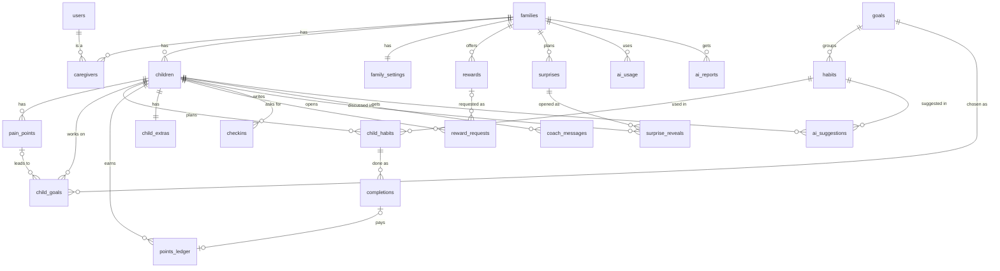
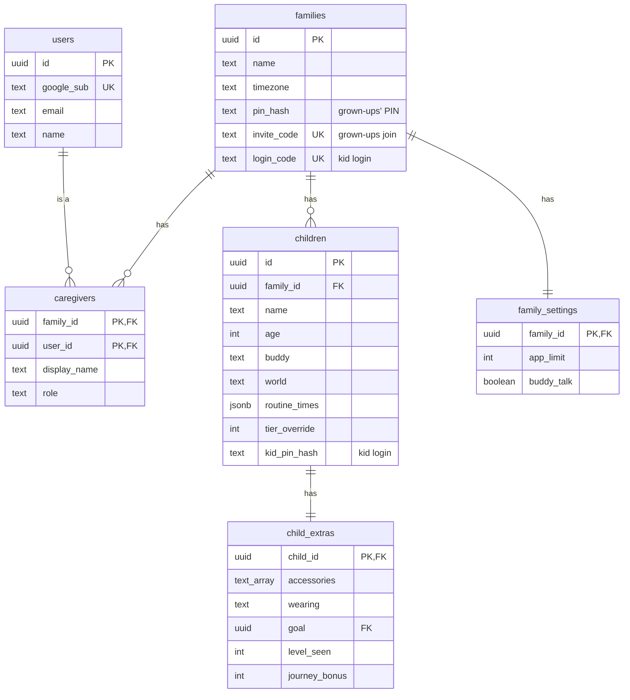
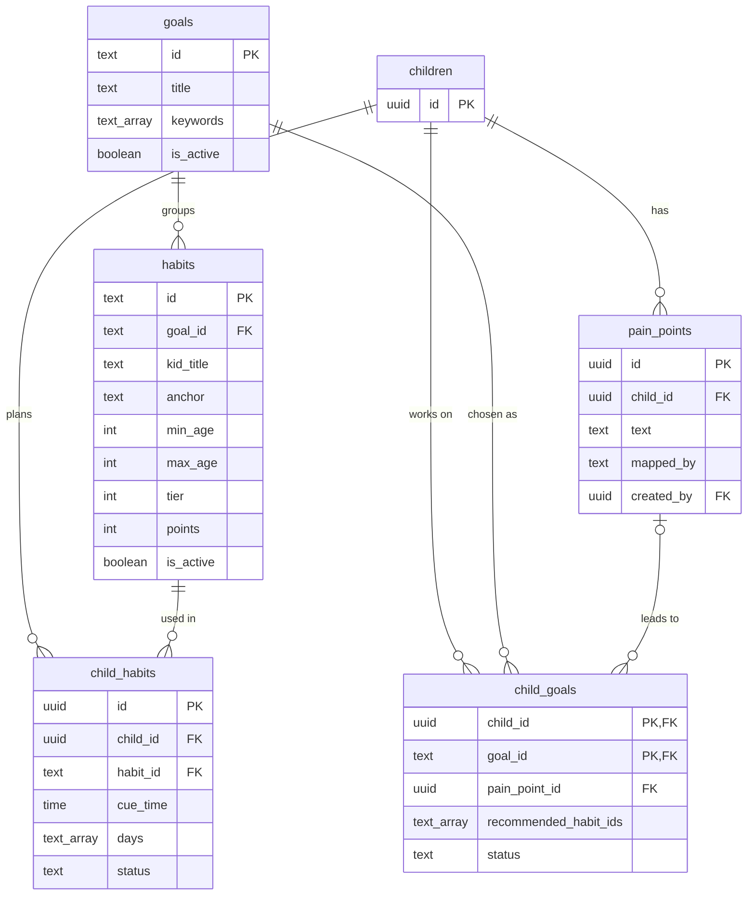
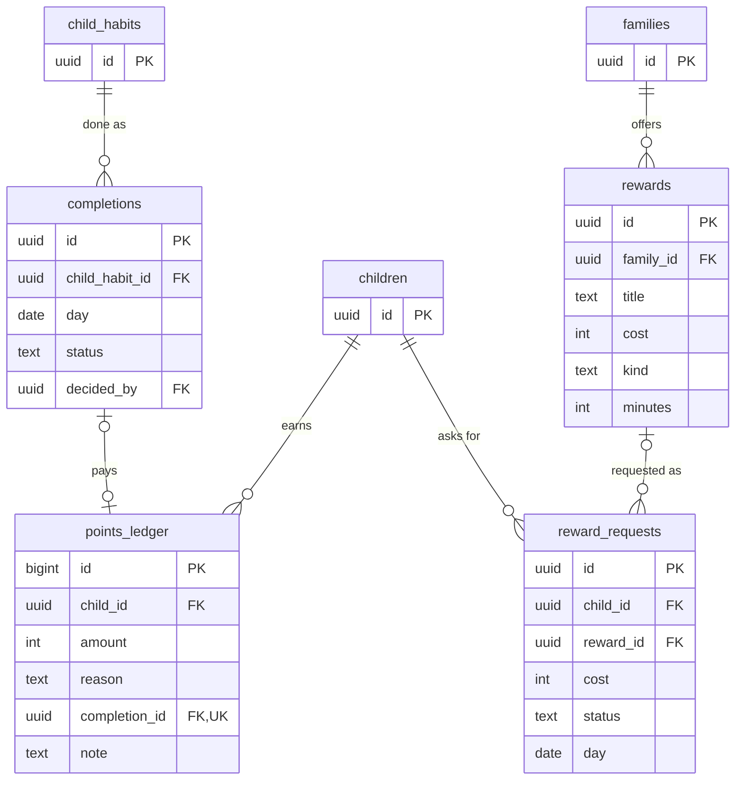
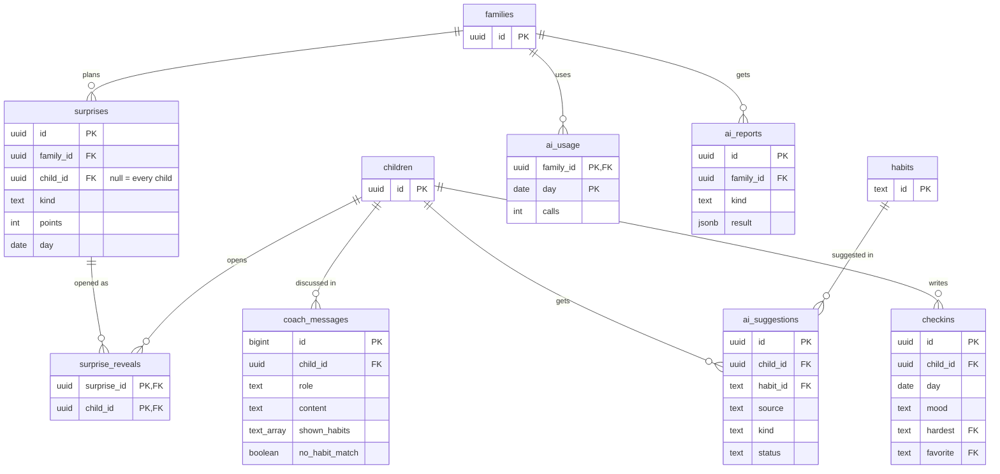

# HabitQuest database schema

The tables of the `hq` schema, how they relate, and what each one is for. The SQL that builds them is in
`db/migrations`. [localsetup.md](localsetup.md) explains how to build a database from it.

Columns marked *kid login* come from `202611030001_kid_login.sql`.

## The whole schema

Every table and how they connect. Below this diagram are the same tables in four smaller diagrams, with their key
columns.

## Families and people

## Catalog and each child's plan

## Daily quests, points and rewards

## Habit coach, check-ins and surprises

A few links are left out of the diagrams to keep them readable:
- The `created_by` and `decided_by` columns of several tables, which point at `users`.
- `checkins.hardest` and `checkins.favorite`, which point at `habits`.
- `child_extras.goal`, which points at `rewards`.
- `surprises.child_id`, which points at `children`.

## What each table is for

| Area | Table | Purpose |
|---|---|---|
| People | `users` | Everyone who signs in as a grown-up, linked to their Google account. Kids aren't users: they use a kid session for one child |
| People | `families` | A household: its name and time zone, the grown-ups' PIN, the invite code another grown-up joins with, and the family code kids sign in with |
| People | `caregivers` | Which grown-ups belong to which family, with their display name and role (mother, father, guardian, other). Every family permission comes from this table |
| People | `children` | Each child: name, age, buddy, current world, the start times of their routines, and their own kid PIN |
| Catalog | `goals` | The pre-approved goals, such as "Calmer bedtimes", with the keywords that match a parent's description of a problem |
| Catalog | `habits` | The pre-approved quests under each goal: the kid's wording, time of day, suitable ages, difficulty tier and points. Only these can go into a plan |
| Plan | `pain_points` | A problem a parent described, and whether the AI, keywords or the parent matched it to goals |
| Plan | `child_goals` | Goals suggested for or chosen for a child, with the reason and the recommended quests |
| Plan | `child_habits` | The child's quest plan: which quest, at what time and on which days. Paused and removed quests stay, as history |
| Daily loop | `completions` | One row per quest per day: the kid marks it done and a grown-up approves or rejects it. Sparks are counted from approved rows |
| Daily loop | `points_ledger` | Every change to a child's points: earned for an approved quest, bonuses, spending, refunds and adjustments. The balance is the sum, and a trigger stops it going below zero |
| Rewards | `rewards` | The family's reward shop: screen time, privileges, outings, toys and mystery boxes, each with a points cost. New families get a default set |
| Rewards | `reward_requests` | A kid's request to spend points on a reward, waiting for a grown-up to approve or decline it |
| Kid extras | `child_extras` | Small per-child state: discoveries, accessories and what the buddy is wearing, the saving goal, opened chests, the last level seen, the journey bonus, and screen-time counters |
| Kid extras | `checkins` | The kid's end-of-day check-in: mood, hardest and favourite quest, stickers and a note. Worrying notes are flagged for a grown-up |
| Kid extras | `surprises` | A note or double-points day a grown-up plans for one child or all of them |
| Kid extras | `surprise_reveals` | Which child has opened which surprise, so each opens only once |
| Family | `family_settings` | Family-wide settings: the daily app time limit and whether the buddy talks |
| AI | `coach_messages` | The habit coach conversation for each child: the parent's messages, the coach's replies with sources, and app notes |
| AI | `ai_suggestions` | Plan changes the AI proposed (add, retime, pause, resume or remove a quest). Nothing changes until a grown-up accepts one with the PIN |
| AI | `ai_usage` | AI calls per family per day, so one family can't run up the provider bill |
| AI | `ai_reports` | The latest AI quest plan and weekly review shown on the dashboard |
| System | `public.hq_migrations` | Which migration files have run, with a fingerprint of each, so `setup_db.py` runs each one exactly once |
