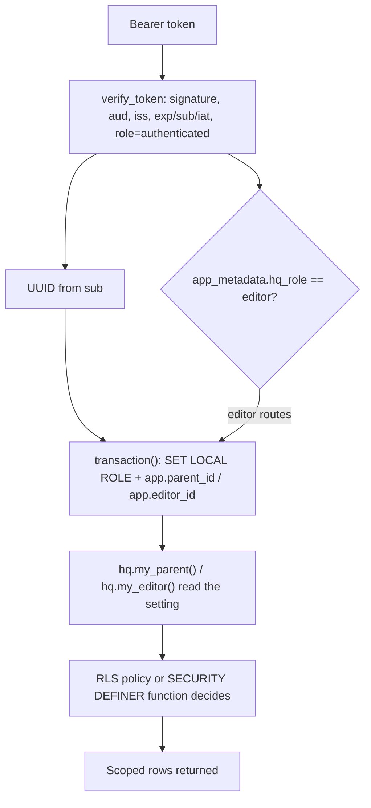

# Authentication, database roles and RLS boundaries

HabitQuest never trusts a request for its own identity: the FastAPI layer converts a bearer token into a UUID, and the database decides what that UUID may see. Authorization is layered so that no single mistake grants cross-household access: the JWT must carry an `authenticated` role, the API opens a transaction under a specific PostgreSQL role, it publishes the caller's identity as a transaction-local setting, and every protected table has row-level security (RLS) keyed off a `hq.my_parent()` / `hq.my_editor()` helper. Editors are a second, wholly separate axis guarded by a claim, a different role, and `SECURITY DEFINER` functions.

## The trust chain in one picture



Each arrow is a hard requirement, not a convention: a valid token without the claim cannot reach `/v1/editor/*`, and a valid claim executed under `hq_api` still cannot read another household's child.

## Token verification

`verify_token` in [`src/habitquest_backend/auth.py`](../../src/habitquest_backend/auth.py) is the only place a JWT is validated. Its behaviour depends on whether a shared secret is configured:

| `settings.jwt_secret` | Key source | Accepted algorithms |
|---|---|---|
| set (`SecretStr`) | the secret itself | `HS256` |
| unset | `jwt.PyJWKClient(settings.jwt_jwks_url).get_signing_key_from_jwt(token).key` | `ES256`, `RS256` |

The two modes map onto the two supported deployments: a legacy Supabase project using symmetric signing (or the native-local dev mode), and a Supabase project that publishes a JWKS document and signs with an asymmetric key. The JWKS path is resolved per call, so a rotated key is picked up without a restart; the client's own set/response caching absorbs the repeated fetches.

Regardless of mode, `jwt.decode` is called with `audience=settings.jwt_audience`, `issuer=settings.jwt_issuer` and `options={"require": ["exp", "sub", "iat"]}`. Three further checks then apply:

- `claims["role"]` must equal the literal `authenticated`, so an anon or service-role token is refused even if its signature is valid;
- `sub` must parse as a `UUID`, which becomes the caller identity;
- with `hq_role` passed, `(claims.get("app_metadata") or {}).get("hq_role")` must equal it.

Any signature, claim-shape, expiry or UUID failure is collapsed into `HTTPException(401, "Invalid or expired parent token")`; only the role-claim check produces `403` (`f"{hq_role.capitalize()} role required"`). That asymmetry matters operationally: a 401 means "get a new token", a 403 means "your token is fine but you are not staff".

Defaults in [`src/habitquest_backend/config.py`](../../src/habitquest_backend/config.py) point `jwt_issuer` at `http://127.0.0.1:54321/auth/v1` and `jwt_jwks_url` at the local Supabase JWKS document, with `jwt_audience="authenticated"`. `JWT_SECRET` is unset by default, so a fresh local install validates asymmetrically until someone deliberately configures the symmetric path.

### `hq_role` is an admin-assigned claim

The editor role is never self-service. `app_metadata` in Supabase Auth is writable only by an administrator or the service-role key, whereas `user_metadata` is writable by the user; the code reads specifically `app_metadata.hq_role`, so a parent cannot promote themselves by editing their profile. `scripts/local_token.py --editor` (via `local_token(..., editor=True)` in [`scripts/local_auth.py`](../../scripts/local_auth.py)) exists only as the development stand-in that mints that claim locally.

## The two API dependencies

[`src/habitquest_backend/main.py`](../../src/habitquest_backend/main.py) defines a `parent` dependency over `HTTPBearer(auto_error=False)`: a missing credential raises `401 "Parent authentication required"`, otherwise `verify_token(credentials.credentials, settings)` returns the UUID. Every `/v1` parent route depends on it; only `/health/live` and `/health/ready` are unauthenticated.

[`src/habitquest_backend/editorial/api.py`](../../src/habitquest_backend/editorial/api.py) mirrors this with an `editor` dependency that additionally passes `hq_role="editor"`. The `/v1/editor` router is registered on the same app, so both credential paths coexist and the editor check is repeated on every editorial endpoint rather than being applied once by a router-level guard.

Authentication is separate from database identity: the API connects as one database login (`settings.database_url`) and downgrades itself per request.

## Per-request database scoping

`transaction()` in [`src/habitquest_backend/db.py`](../../src/habitquest_backend/db.py) is the single chokepoint that turns a caller into a database role and a scoped setting:

```python
@contextmanager
def transaction(
    settings: Settings, parent: UUID | None = None, *, worker: bool = False, editor: UUID | None = None
):
    role = "hq_editor" if editor else "hq_worker" if worker else "hq_api"
    with psycopg.connect(settings.database_url, row_factory=dict_row, connect_timeout=3) as conn:
        conn.execute(f"SET LOCAL ROLE {role}")
        conn.execute("SET LOCAL statement_timeout='10s'")
        conn.execute(
            "SELECT set_config('app.parent_id',%s,true),set_config('app.editor_id',%s,true)",
            (str(parent or ""), str(editor or "")),
        )
        yield conn
```

Four invariants follow from this shape:

1. **Role choice is structural, not caller-controlled.** Passing `editor=<uuid>` is what selects `hq_editor`; passing `worker=True` selects `hq_worker`; the default is `hq_api`. The parameter is only ever supplied from a verified dependency or from internal worker code.
2. **`SET LOCAL` ties the role and the settings to the transaction.** The connection returns to the login role when the block exits, so a pooled or reused connection cannot leak one request's identity into the next.
3. **The identity is a setting, not a bind parameter.** `app.parent_id` and `app.editor_id` are transaction-local strings, set to `''` when absent; `hq.my_parent()` and `hq.my_editor()` apply `NULLIF(...,'')::uuid`, so an unset identity is `NULL` and every comparison against it is false.
4. **A 10-second `statement_timeout` bounds every request transaction**, so a runaway query cannot hold a connection indefinitely.

Call sites show the intended mapping: parent routes pass the verified UUID (`with transaction(settings, user)`), editorial routes pass `editor=user`, and the worker uses `worker=True` — sometimes with a parent id — for its own queue and publication transactions. The worker also opens a second, autocommit connection that sets `SET ROLE hq_worker` and `search_path TO hq_checkpoint` for LangGraph checkpoint persistence.

The template string interpolation of `role` is safe only because `role` is computed from three literals; a change that lets a request influence it would be a SQL injection into the role name.

## RLS: household isolation for parents

The onboarding migration [`supabase/migrations/202610280001_onboarding.sql`](../../supabase/migrations/202610280001_onboarding.sql) creates the roles and the parent-facing policies.

The tenant tables `hq_api` can reach are enabled for RLS and scoped to the caller's own membership:

| Table | Policy | Rule |
|---|---|---|
| `hq.memberships` | `own_membership` | `parent_id = hq.my_parent()`, with `WITH CHECK(parent_id=... AND household_id=hq.my_parent())` added later |
| `hq.households` | `own_household` | `USING (id IN (SELECT household_id FROM hq.memberships))`, `WITH CHECK (id = hq.my_parent())` |
| `hq.children` | `own_child` | `household_id IN (SELECT household_id FROM hq.memberships)` |
| `hq.intakes`, `hq.jobs`, `hq.proposals`, `hq.plans` | `parent_scope` | `parent_id = hq.my_parent() AND child_id IN (SELECT id FROM hq.children)` |
| `hq.child_goals` | `parent_scope` | `parent_id = hq.my_parent() AND child_id IN (SELECT id FROM hq.children)` |
| `hq.plan_flags` | `parent_scope` | `plan_id IN (SELECT id FROM hq.plans WHERE parent_id = hq.my_parent())` |
| `hq.events` | `scoped_events` | `run_id IN (SELECT id FROM hq.jobs)` |

Two consequences are visible in tests and in route behaviour. First, the filter is a *visibility* filter, so a foreign row is invisible rather than forbidden: `GET /v1/plan-runs/{run}` for another household's run returns `404`, not `403`, because `one()` finds no row. Second, the `WITH CHECK` clauses are what stop a caller from writing itself into a household it does not own — a direct `INSERT INTO hq.memberships VALUES(parent, other)` under `app.parent_id = parent` raises `InsufficientPrivilege` (covered by `test_sql_role_cannot_enroll_itself_in_another_household`).

The `hq_worker` role is deliberately outside this model for exactly one table: `worker_queue ON hq.jobs TO hq_worker USING(true) WITH CHECK(true)` lets the worker claim and update jobs across households. Everything else the worker reads is either granted at table level with the parent setting supplied from the claimed job, or reached through the read-only catalog views.

That multi-step parent write in `POST /v1/children` — `INSERT` household, `INSERT` membership, then `UPDATE` the timezone — exists precisely because of these policies: an upsert's new row would have to pass the household `SELECT` policy before the membership row that grants visibility exists.

## Editor separation: a different role with no tenant access

[`supabase/migrations/202610290006_editorial.sql`](../../supabase/migrations/202610290006_editorial.sql) adds `hq_editor`, grants it `USAGE` on schema `hq`, and grants nothing on household tables. `SELECT 1 FROM hq.children` as `hq_editor` therefore fails with `42501`, which is exactly what `supabase/tests/rls.sql` asserts.

Editor writes are restricted by **column-level grants** rather than by RLS, because the catalog tables have no row predicate — every editor may see every catalog row:

- `INSERT(id, version, title, description)` and `UPDATE(title, description)` on `hq.goals`;
- analogous column lists for `hq.concerns`, `hq.habit_versions` and `hq.chapter_templates`, each excluding `status`, `reviewed_by`, `reviewed_at`, `withdrawn_at` and `withdrawn_reason`;
- `created_by` is removed from the reachable surface by giving the columns a default of `hq.my_editor()`, so the author is always the caller and cannot be spoofed;
- detail tables (`hq.habit_levels`, `hq.habit_goals`, `hq.habit_prereqs`, `hq.habit_tags`, `hq.habit_variants`, `hq.concern_goals`) are `SELECT, INSERT, DELETE` only.

Status transitions, release building, publication and withdrawal are unreachable by direct `UPDATE` and are exposed only as `SECURITY DEFINER` functions with `SET search_path=pg_catalog,hq` to prevent object substitution. Each one begins by reading `actor := hq.my_editor()` and raising `42501 'Editor identity required'` when it is `NULL`; `REVOKE ALL ... FROM PUBLIC` plus a targeted `GRANT EXECUTE ... TO hq_editor` keeps them off the other roles' surface.

This is the second half of the trust chain: the setting established by `transaction(settings, editor=user)` is not just metadata, it is the actor the database records in `hq.catalog_audit` and compares for the two-person rules (`Reviewer must differ from author`, `Publisher must differ from release builder`).

## What each role can read: `released_*` versus `release_*` views

The service roles never read catalog base tables. [`supabase/migrations/202610290001_catalog.sql`](../../supabase/migrations/202610290001_catalog.sql) creates four views — `hq.released_goals`, `hq.released_concerns`, `hq.released_chapters`, `hq.released_habits` — each of which joins `hq.release_items` to the entity table and requires both `r.published_at IS NOT NULL` on the release and `status = 'approved'` on the version. `GRANT SELECT ON hq.current_release, hq.released_* TO hq_api, hq_worker` is the only catalog grant those roles hold.

The editorial migration adds a parallel set for staff — `hq.habit_version_details`, `hq.concern_version_details`, `hq.release_goals`, `hq.release_concerns`, `hq.release_chapters`, `hq.release_habits` — granted only to `hq_editor`, and these deliberate gaps define what each side can see:

| Reader | View family | Release filter | Version status filter |
|---|---|---|---|
| `hq_api`, `hq_worker` | `released_*` | `published_at IS NOT NULL` | `status = 'approved'` |
| `hq_editor` | `release_*`, `*_version_details` | none — any release, published or not | none — drafts and in-review included |

`load_release` in [`src/habitquest_backend/catalog/repository.py`](../../src/habitquest_backend/catalog/repository.py) is where this choice is made at runtime: it picks `views = "release" if candidate else "released"`, with `candidate=True` used by the editor endpoints for diff and validation of an unpublished candidate, and the default used by planning, confirmation and proposal edits. Its release-id guard follows the same split — `hq.catalog_releases` for a candidate, `hq.published_releases` otherwise — so a parent-facing path cannot even name an unpublished release.

Practically: publishing a release is what makes content visible to planning, and an editor previewing a candidate cannot inadvertently ship an unapproved version, because the base tables they would have to read are not granted to them.

## RLS and grants as the last line of defence

Route handlers are written as if RLS were the only boundary — they pass a child or run id straight into SQL and rely on visibility. Several checks inside handlers are therefore *refinements*, not the boundary: `one(conn, "SELECT id FROM hq.children WHERE id=%s", ...)` before an `INSERT` exists to turn an out-of-scope id into a clean `404`, and `POST /v1/plan-flags/{flag_id}/resolve` can only touch `resolved_at` because [`supabase/migrations/202610290007_resolve_plan_flags.sql`](../../supabase/migrations/202610290007_resolve_plan_flags.sql) grants `UPDATE(resolved_at)` and nothing else on `hq.plan_flags` to `hq_api`.

The same pattern protects the worker-facing helpers: `hq.lock_intake(uuid)` and `hq.lock_release(text[])` are `SECURITY DEFINER` functions whose bodies re-assert `parent_id = hq.my_parent()` (for the intake) or take `FOR SHARE` locks only (for the release), and both are `REVOKE ALL ... FROM PUBLIC` with narrow grants. `hq.lock_release`'s own documentation notes it confers no write permission, only locks.

A residual risk is documented in the implementation ledger: release validation runs in the API before `hq.publish_release`, so a direct database caller holding `hq_editor` could publish a release the API would have rejected. The two-person rule and the immutability triggers still apply; the *content* validation does not.

## Configuration and operational warnings

| Setting | Effect |
|---|---|
| `JWT_SECRET` | selects the HS256 shared-secret path; when absent, JWKS ES256/RS256 is used |
| `JWT_JWKS_URL` | JWKS document consulted per token when no secret is set |
| `JWT_ISSUER`, `JWT_AUDIENCE` | enforced as `iss` and `aud` on every token |
| `DATABASE_URL` | the single login the API/worker connect as before `SET LOCAL ROLE` |
| `LOCAL_DEMO_AUTH` | gate on the native-local token minting scripts |

> **Warning.** `LOCAL_DEMO_AUTH` and `scripts/local_token.py` mint HS256 development tokens from a shared secret and must stay off on any hosted service. `demo_settings()` refuses to run unless `LOCAL_DEMO_AUTH == "true"` *and* `JWT_SECRET` is set, and `render.yaml` pins `LOCAL_DEMO_AUTH: "false"` for exactly this reason — while generating a `JWT_SECRET` value so the dev path still works if someone flips it. Anyone who can read that secret can forge a parent identity and, with a hand-written `app_metadata.hq_role`, an editor identity. For real users, configure the asymmetric path instead: no `JWT_SECRET`, `JWT_ISSUER=https://<project>.supabase.co/auth/v1`, `JWT_JWKS_URL=.../.well-known/jwks.json`.

Two more deployment facts matter for authorization:

- The migrations create `hq_api`, `hq_worker` and `hq_editor` as `NOLOGIN` roles, so the database user applying them needs `CREATEROLE`. `scripts/setup_db.py` then runs `GRANT hq_api,hq_worker,hq_editor TO CURRENT_USER` so the connecting login can switch into them — without that grant, every `SET LOCAL ROLE` fails.
- The `hq` schema is not in `supabase/config.toml`'s exposed `schemas` list (`["public"]`), so the Data API cannot reach these tables at all; the backend is the only client. A service-role key must never be used as a parent access token — it would carry `role: "service_role"` and be refused by the `authenticated` check, which is the intended defence.

## Where the boundaries are exercised

`supabase/tests/rls.sql` is the pgTAP suite that runs the boundaries as SQL, switching roles inside one transaction: own child visible, other household's child hidden, `UPDATE hq.habit_versions` refused with `42501`, `SELECT FROM hq.habit_version_details` refused for `hq_api`, `SELECT FROM hq.children` refused for `hq_editor`, and `hq.publish_release(hq.build_release('pgtap'))` refused because the builder cannot publish — each case setting `app.parent_id` or `app.editor_id` by hand.

The Python suite covers the layers above it:

- `tests/test_security_and_changes.py` parametrizes bad claim sets (`exp: 0`, wrong `aud`, wrong `iss`, non-UUID `sub`, `role: "anon"`, `sub: None`, future `iat`), a corrupted signature, and a real RSA key signed `RS256` validated through a monkeypatched `PyJWKClient`; `test_other_household_cannot_confirm_or_read_proposal` asserts `404` across the proposal, run, confirm and plan endpoints for a second parent.
- `tests/test_review_regressions.py` asserts the RLS `WITH CHECK` on memberships by expecting `InsufficientPrivilege` from a cross-household membership insert under the victim's `app.parent_id`.
- `tests/test_editorial.py` asserts the editor dependency contract: empty credential `401`, a parent token without the claim `403`, an `hq_role: "support"` token `403`, and an `hq_role: "editor"` token allowed.
- `tests/test_local_scripts.py` asserts that a locally minted editor token verifies with `hq_role="editor"` while a parent token is refused with `Editor role required`, and that `demo_settings()` exits without `LOCAL_DEMO_AUTH=true`.

## Changing this safely

- **Adding a parent-scoped table** means: `ENABLE ROW LEVEL SECURITY`, a `parent_scope`-style policy keyed off `hq.my_parent()`, and explicit `GRANT`s to `hq_api`. RLS without a policy denies everything; a grant without a policy exposes every row.
- **Adding a parent write path** means choosing between a broad `GRANT UPDATE` plus RLS and a narrow column grant. The existing code prefers narrow: `UPDATE(resolved_at)` on `hq.plan_flags`, `UPDATE(timezone)` on `hq.households`, and per-column `UPDATE` lists on `hq.children`.
- **Adding an editor write path** means a column grant that excludes `status`, reviewer and withdrawal columns, and a `SECURITY DEFINER` function with `SET search_path=pg_catalog,hq` for any status change. A direct `UPDATE ... SET status=...` should never be grantable.
- **A new authenticated route** should depend on `Parent` or `Editor`; a route without one of those dependencies runs with whatever identity the surrounding transaction lacks, and `hq.my_parent()` will be `NULL`.
- **Any new catalog view for parents must filter on both `published_at IS NOT NULL` and `status = 'approved'`**, or draft content becomes visible to planning.
- **Never add `app.parent_id` or `app.editor_id` from request data.** They are derived from the verified token only; the value `NULL` is the safe default because every policy comparison against it fails closed.

## Related pages

- [Data model and persistence](data-model-and-persistence.md) — the tables these policies and grants cover.
- [Configuration](../operations/configuration.md) — full `Settings` reference including the JWT variables.
- [Verification strategy](../testing/verification-strategy.md) — how the pgTAP and Python security tests are run.
- [Editorial catalog release](../workflows/editorial-catalog-release.md) — the two-person workflow whose refusals depend on `hq.my_editor()`.
