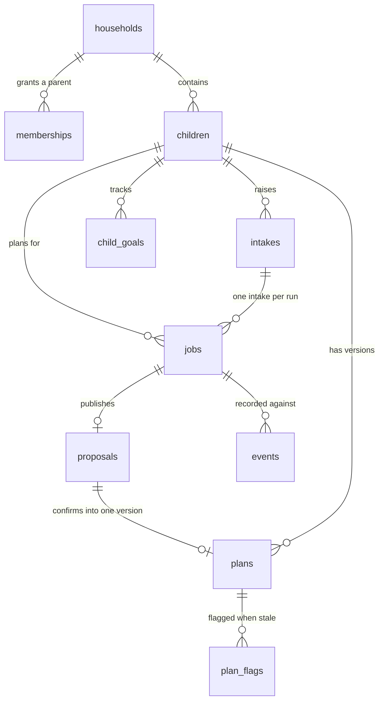
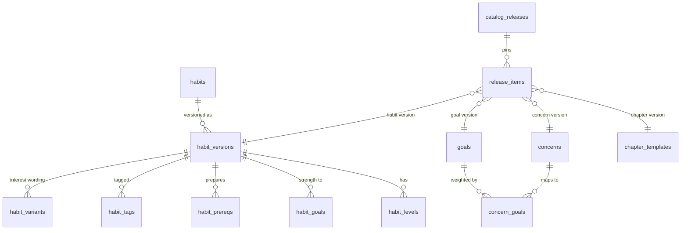

# Data model, migrations and persistence

HabitQuest keeps almost no state in process. A FastAPI parent API and a planning worker share one PostgreSQL database, and everything durable — profiles, planning jobs, proposals, confirmed plans, flags, catalog drafts, published releases, LangGraph checkpoints — lives in that database. The schema is split into three groups by who may touch it: household-side tables scoped by row-level security, catalog/release tables that only `hq_editor` may write and that service roles may read through published views, and the `hq_checkpoint` schema owned by LangGraph's `PostgresSaver`.

This page maps what is stored and how the schema evolves. Authorization mechanics (JWTs, roles, RLS helpers, grants) are covered in [Authentication, database roles and RLS boundaries](authentication-and-authorization.md); the planning pipeline that writes proposals is covered in [Parent planning run](../workflows/parent-planning-run.md); catalog semantics are covered in [Catalog and eligibility](../concepts/catalog-and-eligibility.md).

## Schema layout

| Group | Tables | Written by |
|---|---|---|
| Household | `hq.households`, `hq.memberships`, `hq.children`, `hq.child_goals` | `hq_api` (RLS-scoped to the caller) |
| Planning | `hq.intakes`, `hq.jobs`, `hq.proposals`, `hq.plans`, `hq.plan_flags`, `hq.events` | `hq_api` enqueues and confirms; `hq_worker` claims jobs and publishes proposals |
| Policy | `hq.policy` | migration only (read by both service roles) |
| Catalog | `hq.goals`, `hq.concerns`, `hq.concern_goals`, `hq.habits`, `hq.habit_versions`, `hq.habit_levels`, `hq.habit_goals`, `hq.habit_prereqs`, `hq.habit_tags`, `hq.habit_variants`, `hq.chapter_templates` | `hq_editor` only, drafts directly, status changes through functions |
| Release | `hq.catalog_releases`, `hq.release_items`, `hq.catalog_audit` | `hq_editor` through `SECURITY DEFINER` functions |
| Feedback | `hq.catalog_requests` | `hq_worker` |
| Framework | `hq_checkpoint.*` | `hq_worker` |
| Migration bookkeeping | `public.hq_migrations` | the setup script |

Three very different kinds of state share one schema (`hq`) and are separated only by PostgreSQL grants and RLS, so a schema question ("who can write `proposals`?") is always also an authorization question. The `hq.children` row is the pivot: it carries the durable profile that planning reads, while the household holds only the timezone.

## Household-side entities

The household side of the schema, showing which rows a run creates. `proposals.id` is the same UUID as the job that produced it, and `plans.proposal_id` is unique, so a proposal confirms into at most one plan version.

### Identity: households, memberships, children

`hq.households(id uuid PRIMARY KEY, timezone text)` uses the parent's own UUID as the household id, and `hq.memberships(parent_id, household_id)` records the link. [`POST /v1/children`](../../src/habitquest_backend/main.py) inserts the household and membership with `ON CONFLICT DO NOTHING`, then `UPDATE ... SET timezone`, deliberately not as an upsert: the membership-based SELECT policy cannot see the household row before the membership exists.

`hq.children` holds `name`, `age_band` constrained to `'6-9'`/`'10-13'`, and — added by [`202610290003_profile.sql`](../../supabase/migrations/202610290003_profile.sql) — `interests`, `accessibility` and `opted_in_topics` (`text[]`), `preferred_world` (`space`/`forest`/`city`), `routine_schedule` (`jsonb`, keyed by anchor) and `profile_version`. Planning reads that row through `profile_from_row()` in [`catalog/models.py`](../../src/habitquest_backend/catalog/models.py), so the profile columns are effectively a typed contract: `routine_schedule[anchor] = {cue, days}` decides which habits can be scheduled at all, because a habit needs a cue for its `routine_anchor`.

`profile_version` is the optimistic-concurrency token for the whole profile. `PATCH /v1/children/{id}` sends `expected_profile_version`, the handler updates with `... profile_version+1 WHERE id=%s AND profile_version=%s`, and a zero-row result becomes `409 "Profile changed; reload it before editing"`. The same number is copied into each proposal's `data.profile_version`, so a proposal built on an older profile can neither be edited nor confirmed.

### Intakes and jobs

`hq.intakes(id, child_id, parent_id, version, data jsonb, created_at)` stores one round of the parent's concerns plus `available_minutes` and `store_feedback` in `data`. `version` is an edit counter: nothing in the application increments it today, but both `confirm()` and the worker compare `intake["version"]` to the value recorded on the job and refuse with a conflict if it moved, and [`tests/test_security_and_changes.py`](../../tests/test_security_and_changes.py) exercises that path with a raw `UPDATE hq.intakes SET version=version+1`.

`hq.jobs` is the work queue and the run record at once:

| Column | Purpose |
|---|---|
| `status` | `queued`, `running`, `ready`, `failed`, `cancelled` |
| `kind` | `plan` (only kind the worker claims) or `analysis` |
| `request_key` + unique `(parent_id, request_key)` | idempotency, so a retried `POST /v1/intakes/{id}/plan-runs` returns the same run |
| `intake_version`, `base_plan_version` | the exact state the run was computed against |
| `attempts`, `available_at`, `lease_until`, `lease_token` | at-least-once claiming with fencing |
| `checkpoint_thread`, `resume_thread` | LangGraph thread ids; each attempt gets a fresh branch |
| `deadline`, `model_calls`, `reserved_tokens` | persisted run budget |
| `error`, `analysis` | failure reason, and the analysis job payload |

Partial index `jobs_available ON hq.jobs(available_at) WHERE status IN ('queued','running')` keeps the claim query cheap. [`worker.claim()`](../../src/habitquest_backend/worker.py) does three things in one transaction: fail jobs past `deadline`, fail jobs past `max_attempts`, then `SELECT ... FOR UPDATE SKIP LOCKED LIMIT 1` on `kind='plan'`. The claim `UPDATE` is where the checkpoint branch rotates — `resume_thread=checkpoint_thread, checkpoint_thread=id::text||':'||<lease>` — which is why a retried attempt never mutates the branch the previous attempt was writing.

### Proposals and plans: the whole document in `jsonb`

`hq.proposals(id uuid PRIMARY KEY REFERENCES hq.jobs, ...)` and `hq.plans(...)` both store the entire plan document in a single `data jsonb` column. Nothing in the document is normalized: goals, active habits, future candidates, per-goal shortlists with score breakdowns, routine links, chapter outline, `unresolved` reasons, questions, rationale, review result and `fallback` all live inside one JSON value that [`planning.build_proposal()`](../../src/habitquest_backend/planning.py) constructs and [`service.py`](../../src/habitquest_backend/service.py) copies forward on confirmation.

This is the most important persistence fact on this page for anyone changing the feature: **a schema change to the plan document is a code change, not a migration.** Adding, renaming or removing a field in the proposal or plan payload means editing `build_proposal()`, `entry()` and `revalidate_carried()` in [`planning.py`](../../src/habitquest_backend/planning.py), the patch operations in `edited()`/`apply_patch()` in [`service.py`](../../src/habitquest_backend/service.py), the `ProposalPatch`/`Confirmation` schemas in [`schemas.py`](../../src/habitquest_backend/schemas.py), and any SQL that reaches into the document. Two places already do the latter: `hq.withdraw_habit()` walks `p.data->'active'` with `jsonb_array_elements` to flag plans that use a withdrawn habit, and `cue_loss_habits()` reads `data["active"]` to flag cue removal. Neither knows about a new field automatically.

Because the document is denormalized, the version columns around it carry the invariants that a normalized schema would carry with foreign keys:

- `plans.UNIQUE(child_id, version)` plus `proposals.id` = the job id plus `plans.proposal_id UNIQUE` give "one plan per proposal, one plan version per child number".
- `proposals.version` increments on every `PATCH /v1/proposals/{id}`, so `expected_proposal_version` detects a concurrent edit.
- `proposals.expires_at` defaults to `now() + interval '7 days'`; the confirm and patch handlers read `expires_at <= now() AS expired`.
- `proposals.confirmed boolean` is set after the plan insert, and `confirm()` first checks `SELECT * FROM hq.plans WHERE proposal_id=%s` so a retry returns the existing plan rather than creating a second version.
- `proposals.release_id` and `plans.release_id` record which catalog release the document was validated against. A `NULL` means "built from the retired pre-release catalog"; the worker explicitly refuses to carry such a plan forward (`base["data"] if base and base["release_id"] is not None else {}`).

`hq.plans` is append-only in practice: version `n+1` is a new row, never an `UPDATE` of version `n`, and the GET handler reads `ORDER BY version DESC LIMIT 1`.

### Child goals, flags and events

`hq.child_goals(child_id, goal_id, status, since_plan_version, source_intake_id)` records goal lifecycle (`active`, `paused`, `resolved`) with `PRIMARY KEY(child_id, goal_id)`. `confirm()` upserts one row per `covered` goal with `ON CONFLICT ... DO UPDATE ... WHERE hq.child_goals.status <> 'active'`, so re-confirming a goal that is already active leaves its original `since_plan_version` and originating intake intact — the history stays attributable.

`hq.plan_flags(plan_id, kind, habit_id, reason, created_at, resolved_at)` records staleness against a confirmed plan, with `kind` in `habit_withdrawn`, `cue_removed`, `level_removed` and `reason` capped at 300 characters. Only two of those kinds have writers: `hq.withdraw_habit()` inserts `habit_withdrawn` for each child's newest plan containing the habit, and the profile `PATCH` handler inserts `cue_removed` via `service.flag_plan()`; `level_removed` is declared in the `CHECK` and granted in the API but is currently produced by nothing — a level disappearing shows up instead as a `drop` change in the next proposal's `changes` list. Two resolvers exist, both writing only `resolved_at`: `POST /v1/plan-flags/{id}/resolve`, and `confirm()`, which resolves every open flag on the plans a new version supersedes.

`hq.events(id bigint IDENTITY, run_id uuid REFERENCES hq.jobs ON DELETE CASCADE, kind, data jsonb, created_at)` is the run log, keyed to the job. The worker's `record()` inserts `model`, `tool`, `validation`, `review` and `fallback` events, each carrying IDs, roles, counts and outcome metadata rather than raw prompts. Cascade delete means deleting a job removes its history; nothing else reads events today, but they are the only durable record of why a run produced what it did.

### `hq.policy` and the historical renames

`hq.policy(name PRIMARY KEY, version, max_active_habits)` holds one row, `('onboarding', 1, 3)`. It is the schema-level expression of a product limit: `max_active_habits` is read by `apply_patch` and by the planner, and `version` is copied into each proposal as `data.policy_version` so a change invalidates proposals built under the old value. `hq.lock_release()` — the helper `validate_sources()` calls before revalidating — takes `FOR SHARE` on this row, on the current release and on the referenced habit versions, so a policy edit or a publication cannot interleave with a planning or confirmation transaction.

Several names in the schema still carry older meaning, and reading them literally misleads:

| Present name | Was | Notes |
|---|---|---|
| `hq.intakes` | `hq.sessions` | renamed in [`202610290004_intake_switch.sql`](../../supabase/migrations/202610290004_intake_switch.sql); the concept moved from "one onboarding session" to "one repeatable round of concerns" |
| `hq.jobs.intake_id` | `session_id` | renamed in the same migration |
| `hq.jobs.intake_version`, `hq.proposals.intake_version` | `session_version` | renamed; still the intake's version counter |
| `hq.lock_intake(uuid)` | `hq.lock_session(uuid)` | dropped and recreated; `202610290003_profile.sql` still declares `child_goals.source_intake_id REFERENCES hq.sessions` because the rename had not happened yet |
| dropped: `hq.intakes.goals_confirmed` | | the flag became meaningless once goals moved to `hq.child_goals` |
| dropped: `hq.preferences` | | plan-derived preferences were migrated into `hq.children.preferred_world` / `routine_schedule` by the same migration, which also backfilled `hq.households.timezone` from the newest intake |
| dropped: `hq.catalog`, `hq.chapters` | | the unversioned pre-release catalog, retired once `released_*` views covered planning |

`hq.lock_sources(text[], text[])` from the earlier publication locks (`202610280004_publication_locks.sql`) was dropped along with it; only `hq.lock_release()` remains as the release-aware replacement. That migration is also the one that writes off state it can no longer serve: queued or running `analysis` jobs are cancelled, and unconfirmed proposals with `release_id IS NULL` get `expires_at = now()` so they read as expired rather than silently quoting a catalog that no longer exists.

## Catalog, release and feedback tables

The catalog side, showing why a release is a pin rather than a copy: `release_items` holds `(entity, entity_id, version)` triples that name rows in the live catalog tables, and the `released_*` views join them back under `published_at IS NOT NULL` and `status = 'approved'`. `hq.catalog_audit` is omitted because it is polymorphic — it stores `(entity, entity_id, version)` for all four kinds rather than a foreign key to any one table.

### Versioned catalog rows

Every catalog entity is `(id, version)`-keyed and carries a two-person review lifecycle: `status` in `draft`, `in_review`, `approved`, `rejected`, with `created_by`, `reviewed_by`, `reviewed_at`. A table-level `CHECK(status <> 'approved' OR (reviewed_by IS NOT NULL AND reviewed_at IS NOT NULL AND reviewed_by <> created_by))` makes self-approval impossible even with direct SQL access, which is why [`tests/test_catalog_schema.py`](../../tests/test_catalog_schema.py) asserts a `CheckViolation` for `reviewed_by = created_by`.

`hq.habits` is just an id registry; all content is in `hq.habit_versions`, and the detail tables (`habit_levels` with `simple`/`standard`/`stretch`, `habit_goals` strengths, `habit_prereqs` with only the `prepares` kind, `habit_tags` matching `^(interest|topic|access):[a-z_]+$`, `habit_variants` keyed by interest) hang off `(habit_id, version)` with `ON DELETE CASCADE`. `hq.goals` and `hq.concerns` are keyed `(id, version)` directly; `concern_goals` maps a concern version to weighted goals.

The `released_habits` view is what collapses this back into the flat shape the application loads: `catalog/repository.py` `load_release()` reads `SELECT * FROM hq.released_habits WHERE release_id=%s` and gets `levels`, `goals`, `tags`, `variants` and `supports` as pre-aggregated `jsonb`/arrays, matching the frozen dataclasses in `catalog/models.py`. That is the boundary between a normalized authoring schema and a denormalized read model — and the reason a new habit attribute needs both a detail table and a view change.

### Immutability guards

Immutability is enforced by trigger functions, not by convention, and the guards were hardened in [`202610290002_catalog_guards.sql`](../../supabase/migrations/202610290002_catalog_guards.sql) after the first version left races open:

- `hq.guard_approved_version()` compares `to_jsonb(NEW)` to `to_jsonb(OLD)` minus `withdrawn_at`/`withdrawn_reason` and raises `42501`; withdrawal is the only permitted change, and once withdrawn it can be neither rewritten nor undone.
- `hq.guard_habit_detail()` and `hq.guard_concern_detail()` `SELECT ... FOR SHARE` the parent version row before checking its status, so an approval cannot land between the check and the write. They reject both `approved` and — since [`202610290006_editorial.sql`](../../supabase/migrations/202610290006_editorial.sql) — `in_review` parent versions.
- `hq.guard_review_version()` freezes a version while `status = 'in_review'`, leaving the lifecycle functions as the only writers.
- `hq.guard_published_release()` and `hq.guard_release_items()` make publication final apart from `is_current` and `notes`.

The same pattern explains the grants: `hq_editor` gets `INSERT`/`UPDATE` on named columns only (`GRANT INSERT(id, version, title, description), UPDATE(title, description) ON hq.goals TO hq_editor`), so an editor cannot set `status`, `reviewed_by` or `withdrawn_at` directly even if they bypass the API.

### Releases and the current-release pointer

`hq.catalog_releases(id int PRIMARY KEY, built_by, published_by, published_at, notes, is_current)` models a numbered, signed release. `CHECK((published_by IS NULL) = (published_at IS NULL))` ties publication to its actor; `CHECK(published_by IS NULL OR published_by <> built_by)` requires a second editor; and `CREATE UNIQUE INDEX one_current_release ON hq.catalog_releases(is_current) WHERE is_current` guarantees at most one current release — the partial unique index is the enforcement, not application logic.

`hq.release_items(release_id, entity, entity_id, version)` is the pin list, `PRIMARY KEY(release_id, entity, entity_id)` with `entity` in `goal`/`concern`/`habit`/`chapter`. Building and publishing happen in `SECURITY DEFINER` functions rather than in Python:

- `hq.build_release(notes, source_release)` takes advisory lock `29102026`, allocates `max(id)+1`, and either pins `max(version)` per approved entity (excluding withdrawn habit versions) or, for a rollback, copies a published release's items minus withdrawn habits.
- `hq.publish_release(target)` re-takes the same advisory lock, refuses an already-published release, refuses when the publisher is the builder, then clears `is_current` and sets it on the target in the same statement pair.
- `hq.transition_version(kind, id, version, action, why)` performs `submit`/`approve`/`reject` with `FOR UPDATE` on the row, enforces `Reviewer must differ from author`, and writes every transition to `hq.catalog_audit(entity, entity_id, version, from_status, to_status, actor, reason, at)`.
- `hq.withdraw_habit(habit_id, why)` sets withdrawal on every approved version, audits it as `approved` → `withdrawn`, and inserts `plan_flags` rows, returning how many plans were flagged.

Application-side validation in `catalog/releases.py` is deliberately separate from these guards: `validate_release()` produces `errors` (missing world × goal chapter, dangling references, withdrawn habit, habit without levels) and `warnings` (a goal with no habit covering an age band), and only the API's `publish` route treats errors as blocking. The database would happily publish an invalid release; validation lives in the caller.

### Read models

| View | Audience | Contents |
|---|---|---|
| `hq.current_release` | `hq_api`, `hq_worker`, `hq_editor` | the single `is_current` id |
| `hq.published_releases` | `hq_api`, `hq_worker` | all published ids, so a candidate release can be distinguished from a published one |
| `hq.released_goals/_concerns/_habits/_chapters` | `hq_api`, `hq_worker` | published **and** approved rows only |
| `hq.release_goals/_concerns/_habits/_chapters` | `hq_editor` | any release, published or not — the candidate view |
| `hq.habit_version_details`, `hq.concern_version_details` | `hq_editor` | any status, with the detail aggregates, so the review queue can read drafts |

`load_release(conn, release_id, candidate=False)` selects the view family by switching the prefix between `released` and `release`, which is the only place the two parallel view sets are reconciled. `tests/test_catalog_schema.py` pins the security property: a draft habit added to an unpublished release is invisible through `released_habits` to both `hq_api` and `hq_worker`.

### `hq.catalog_requests`

`hq.catalog_requests(phrase_hash UNIQUE, normalized_phrase, count, first_seen, last_seen)` is the only *aggregate* table in the schema: `worker.store_catalog_requests()` lowercases and whitespace-normalizes each unmatched phrase, hashes it with MD5 (32 hex characters, enforced by `CHECK(char_length(phrase_hash) = 32)`), and upserts with `count = count + 1`. It deliberately holds no child, parent or household identifier, which is why it is the one table with no RLS and no household relationship. Rows are written only when the intake set `store_feedback: true`.

## Migrations: forward-only, checksummed, advisory-locked

There is no migration framework. [`scripts/setup_db.py`](../../scripts/setup_db.py) is the entire mechanism, and it is intentionally small:

1. `SELECT pg_advisory_xact_lock(28102026)` serializes concurrent runs, so two service instances starting at once cannot both apply the same file.
2. `CREATE TABLE IF NOT EXISTS public.hq_migrations(name text PRIMARY KEY, digest text NOT NULL)` — the bookkeeping table lives in `public`, not `hq`, so it survives anything that happens to the application schema.
3. For each `supabase/migrations/*.sql` in sorted (i.e. filename-timestamp) order, SHA-256 the file text and compare with the stored digest. A file already recorded with a **different** digest raises `RuntimeError("Applied migration changed: ...")`, which converts an edited-after-apply migration into a startup failure rather than silent drift.
4. For a new file, first ask whether the Supabase CLI already applied it (`to_regclass('supabase_migrations.schema_migrations')` and a lookup by the numeric filename prefix), apply the text only if not, then record the digest either way.
5. `GRANT hq_api,hq_worker,hq_editor TO CURRENT_USER` so the connecting login can `SET LOCAL ROLE` into the NOLOGIN roles.
6. Run `supabase/seed.sql`.
7. Create the LangGraph checkpoint schema with `PostgresSaver.from_conn_string(..., options="-c search_path=hq_checkpoint").setup()`, then grant `hq_worker` usage on the schema plus `SELECT,INSERT,UPDATE,DELETE` on its tables.

Two properties follow. First, migrations are **forward-only**: nothing is rolled back, and there is no down-migration path, so a bad change is corrected by a later file. Second, the script **never resets** an existing database — the only destructive statements are the explicit `DROP`/`UPDATE` steps inside individual migrations, each paired with a data migration in the same file (the intake switch is the model: backfill profile columns, then `DROP TABLE hq.preferences`).

Operational consequences worth knowing:

- The role creation (`CREATE ROLE ... NOLOGIN` guarded by `pg_roles` lookups) runs as the connecting user, so that user needs `CREATEROLE`.
- `scripts/render_start.sh` runs `python scripts/setup_db.py` before `uvicorn`, so a deployment applies pending migrations at boot; `RUN_WORKER_IN_API=true` then starts the worker on a thread in the same process.
- `GET /health/ready` is the schema smoke test: it executes `SELECT 1 FROM hq.children LIMIT 0` as the default `hq_api` role and returns 503 on any `psycopg.Error`, so "database unreachable" and "migrations not applied" collapse into one readiness failure.
- The migration list is also the schema's history: `202610280001`–`004` onboarding, budgets, analysis jobs and the lock helpers; `202610290001`–`002` the versioned catalog and its hardened guards; `003` profile/intake/child_goals; `004` the intake switch and old-catalog removal; `005` plan_flags and catalog_requests; `006` the editorial workflow; `007` a one-line grant. See [Deployment and migrations](../operations/deployment-and-migrations.md) for the operational side.

## The `hq_checkpoint` schema

`hq_checkpoint` is created by migration `202610280001_onboarding.sql` as an empty schema; its tables are created by LangGraph, not by this repository. [`worker.run_once()`](../../src/habitquest_backend/worker.py) opens a second, autocommit connection with `SET ROLE hq_worker` and `SET search_path TO hq_checkpoint`, then hands `PostgresSaver(cp)` to `generate()`:

- The `checkpoint_thread` is `<job id>:<lease token>`, so each attempt writes a distinct branch and an old worker whose lease expired cannot mutate the branch the new attempt is using.
- `resume_thread` points at the previous attempt's branch; `plan_with_agents()` copies a non-empty snapshot into the new branch via `update_state()`, choosing `as_node` based on whether the previous run stopped before or after the model call.
- Checkpoints contain the private context a run was given, which is why the README treats retention and family erasure as unsolved and why tracing is disabled around model calls.

Nothing outside `worker.py` reads these tables, and no application code joins them to `hq` tables. They are persistence for the agent runtime, isolated by schema, role and search_path precisely so a bug in checkpointing cannot reach household data.

## Seeding

[`supabase/seed.sql`](../../supabase/seed.sql) is a single idempotent `DO` block (`IF EXISTS(SELECT 1 FROM hq.catalog_releases WHERE id = 1) THEN RETURN;`) that builds "release 1" — the development catalog migrated into the versioned model. It inserts five goals, four concerns with synonyms and weights, five habits with one `standard` level each, goal strengths, one `prereq` (`pack-bag` prepares `morning-ready`), tags, `space` variants for two habits, and fifteen chapter templates (5 goals × 3 worlds). It then flips every status to `approved` with a fixed reviewer UUID different from the author UUID — satisfying the two-person `CHECK` — inserts `catalog_releases` row 1 plus matching `release_items`, and publishes it as `is_current`.

This is the only legitimate path that sets `status='approved'` with a direct `UPDATE`, and it can because seeding runs as the administrative connection before any role-switching. The file is a **development fixture**, labeled as such in its own comment and in the README: expectations in `scripts/demo.py`, `tests/conftest.py` and `tests/test_catalog_schema.py` (`test_release_one_is_current_and_complete`) all assume its exact content. Note that `hq.policy` is *not* seeded here — the migration inserts `('onboarding',1,3)`, and `tests/conftest.py` re-inserts it after truncating.

## Invariants and failure behaviour

| Invariant | Enforced by |
|---|---|
| one plan version per child and number | `UNIQUE(child_id, version)` on `hq.plans` |
| a proposal confirms at most once | `plans.proposal_id UNIQUE` and the `previous` lookup in `confirm()` |
| one current release | partial unique index `one_current_release` |
| approved and published catalog rows never change | `guard_approved_version`, `guard_*_detail`, `guard_published_release`, `guard_release_items` |
| reviewer ≠ author, publisher ≠ builder | table `CHECK`s plus the same checks in `transition_version` / `publish_release` |
| a run cannot publish against a stale intake, plan base or profile | `intake.version`, `current_version()`, `children.profile_version` compared under `FOR UPDATE`/advisory lock in `confirm()` and at the end of `run_once()` |
| a proposal cannot quote a withdrawn or superseded habit | `hq.lock_release()` + `stale_references()` in `validate_sources()` |
| a policy change invalidates in-flight proposals | `policy_version` copied into the document and compared |
| expired leases cannot publish | `lease_token` in every publishing `UPDATE ... WHERE` |

The failure modes are designed to fail closed and leave no partial state. `run_once()` wraps publication in one transaction: re-read the job `FOR UPDATE` while checking `lease_token`, `lease_until > now()` and `deadline > now()`, re-check intake version and plan version, re-check profile version, then `validate_sources()` and insert the proposal. Any mismatch raises `ValueError("State changed while planning")` and the job is marked `failed`. Budget exhaustion raises `BudgetExceeded` from the `charge()` `UPDATE`, which is conditional on `model_calls < max_model_calls AND reserved_tokens + n <= max_run_tokens` — a rejected charge means no publication. Provider and infrastructure exceptions are the only ones that requeue (`status = CASE WHEN attempts >= max_attempts THEN 'failed' ELSE 'queued' END` with `available_at = now() + attempts*2` backoff).

## Extension points

- **New catalog attribute**: add a column to `habit_versions` (or a new detail table with the same `(habit_id, version)` cascade) in a new migration, extend the corresponding `released_habits`/`habit_version_details` view, extend the dataclass in `catalog/models.py` and `load_release()`, and extend `HabitDraft` plus `editorial/api.py`'s `KINDS` column list so editors can author it.
- **New plan-document field**: no migration. Change `build_proposal()`, `entry()`, `edited()`/`apply_patch()`, the `schemas.py` models, and any SQL that walks `data` (currently `withdraw_habit()` and `cue_loss_habits()`).
- **New job kind**: `hq.jobs.kind` has a `CHECK` listing `plan` and `analysis`; the worker's claim query filters `kind='plan'`, so a new kind needs both a migration and a claim-path change.
- **New limit**: `hq.policy` is a one-row table by design; adding a limit means a column and a `version` bump, which automatically invalidates proposals built under the old policy version.

## Tests that pin the schema

- [`tests/test_catalog_schema.py`](../../tests/test_catalog_schema.py) — approved-version and detail immutability, permanent withdrawal, single current release, frozen published items, and the property that `hq_api`/`hq_worker` cannot read any catalog base table.
- [`tests/test_profile_schema.py`](../../tests/test_profile_schema.py) — profile column defaults, `child_goals` RLS scoping, column-level `UPDATE` grants, and that service roles can call `hq.lock_release()`.
- [`tests/test_plan_flags_schema.py`](../../tests/test_plan_flags_schema.py) — `plan_flags` RLS enabled, `kind` constraint, `catalog_requests` upsert counting, and the flag→confirm resolution lifecycle.
- [`tests/test_database_flow.py`](../../tests/test_database_flow.py) and [`tests/test_security_and_changes.py`](../../tests/test_security_and_changes.py) — end-to-end persistence: idempotent job creation, cross-household invisibility, and each source-change path (`WITHDRAW`, `EMPTY_RELEASE`, policy bump, proposal expiry, intake version, proposal version) returning 409 with zero plans written.
- [`tests/test_recovery.py`](../../tests/test_recovery.py) — lease reclaim and fencing, budget-blocked publication, retry/backoff, and "no proposal row" assertions after every failure path.
- `tests/conftest.py` truncates the full household and catalog table set and re-runs `supabase/seed.sql`, so the seeded release-1 content is itself a fixture dependency.
