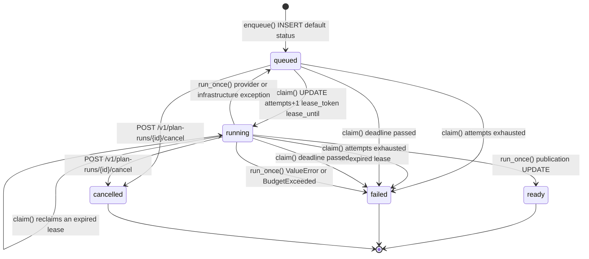
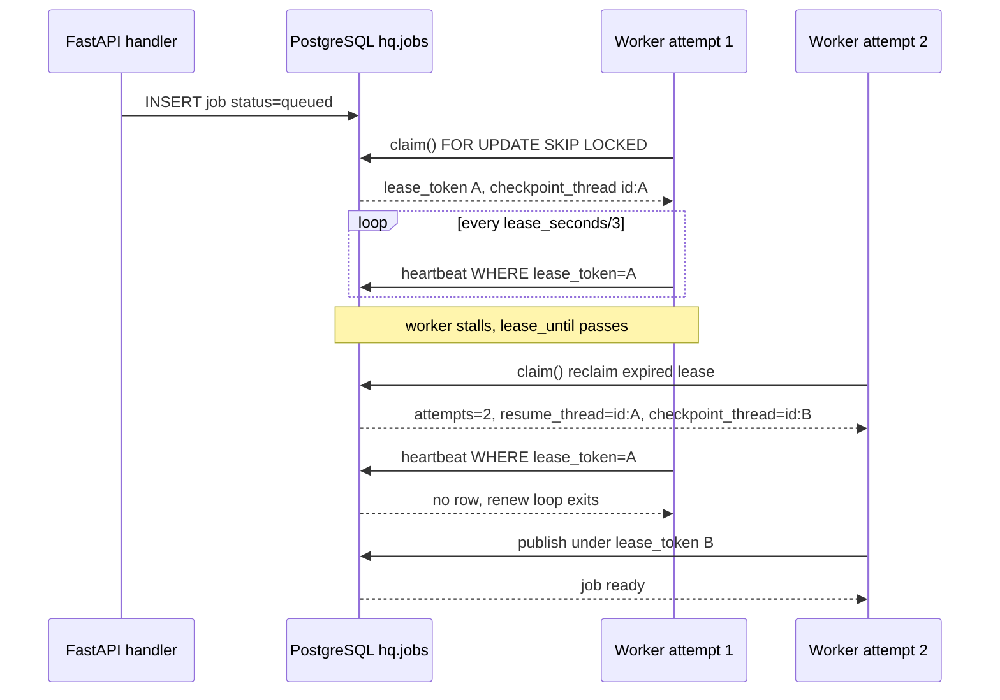

# Runtime topology: API process, worker loop and job leases

HabitQuest runs as up to two processes that share one PostgreSQL database and no other state. The API process answers HTTP and writes queue rows; the worker process claims those rows, runs the Deep Agents planning pipeline and publishes proposals. Neither calls the other directly: `hq.jobs` is the only channel between them, and every durability property on this page follows from that.

This page covers process entrypoints, the in-API worker thread, and the job lifecycle with its leases, deadlines, budgets, fencing and retry classification. For the schema those rows live in, see [Data model, migrations and persistence](data-model-and-persistence.md); for the planning algorithm the worker invokes, see [Parent planning run](../workflows/parent-planning-run.md); for the deployment side, see [Deployment and migrations](../operations/deployment-and-migrations.md).

## Two entrypoints, one queue

| Entrypoint | Defined in | Role |
|---|---|---|
| `uvicorn habitquest_backend.main:app` | [`main.py`](../../src/habitquest_backend/main.py) | the FastAPI application; `app = create_app()` at import time |
| `hq-worker` | `[project.scripts]` in [`pyproject.toml`](../../pyproject.toml) → `habitquest_backend.worker:main` | the standalone polling worker |
| `python -m habitquest_backend.worker` | the module's `if __name__ == "__main__": main()` | the same worker, invoked as a module |

`pyproject.toml` declares `hq-worker = "habitquest_backend.worker:main"`, so the console script and the module form are the same function. `main()` parses exactly one flag, `--once`, builds `Settings()` from the environment, and then loops: `run_once(settings)`; return after one pass if `--once`; otherwise `time.sleep(1)` when no job was claimed. With no `--once`, the loop has no stop condition other than process death — there is no signal handler, so the standalone worker is meant to be run under a supervisor that kills it.

The API process has no background scheduler of its own beyond the optional worker thread described below. Every HTTP handler, including `/health/live` and `/health/ready`, is synchronous (`def`, not `async def`) and opens its own psycopg connection per transaction through `db.transaction()`. There is no connection pool: `transaction()` calls `psycopg.connect(...)` with `connect_timeout=3` and closes on exit. The consequence that matters operationally is that a request's cost is dominated by connection setup, and that the process holds no long-lived database handles except inside the worker.

## Single-service hosting: `RUN_WORKER_IN_API`

`create_app(settings)` installs a FastAPI lifespan that starts the worker on a thread beside the API:

```python
@asynccontextmanager
async def lifespan(_: FastAPI):
    # Single-service hosting: the planning worker polls on a thread beside the API.
    stop = threading.Event()
    thread = threading.Thread(target=serve, args=(settings, stop), name="plan-worker", daemon=True)
    if settings.run_worker_in_api:
        thread.start()
    yield
    stop.set()
    if thread.is_alive():
        thread.join(timeout=settings.max_run_seconds)
```

The details that matter:

- The `Thread` object is always constructed, but only started when `settings.run_worker_in_api` is true. `Settings.run_worker_in_api` defaults to `False`, so local development and tests run the API without a hidden worker unless they opt in.
- The thread is a daemon named `plan-worker`; [`tests/test_hosting.py`](../../tests/test_hosting.py) asserts after the `TestClient` context exits that no thread with that name survives, which is how the shutdown path is pinned.
- Shutdown sets `stop`, which `serve()` observes through `stop.wait(1)` between idle passes, and then joins with `timeout=settings.max_run_seconds`. Because the join is bounded and the thread is a daemon, a run that is mid-model-call cannot block process exit; it is abandoned, and its lease expires.
- `worker.serve(settings, stop)` swallows every exception from a pass: it logs `"Worker pass failed"` and treats the pass as "no work", waiting one second before retrying. A database restart, a bad model key or a malformed job therefore degrades the loop rather than killing it. `test_serve_survives_a_failed_pass_and_stops` in [`tests/test_hosting.py`](../../tests/test_hosting.py) drives exactly that sequence.

`scripts/render_start.sh` is the deployment expression of this arrangement:

```sh
set -eu
python scripts/setup_db.py
exec python -m uvicorn habitquest_backend.main:app --host 0.0.0.0 --port "${PORT:-8000}"
```

Migrations are applied at boot, then uvicorn replaces the shell. [`render.yaml`](../../render.yaml) sets `RUN_WORKER_IN_API: "true"` on a single free `web` service and keeps the separate `worker` service commented out with the note that it "needs a paid instance type". **A free Render instance sleeps when idle and stops the worker with it**: a plan run enqueued while the service is asleep stays `queued` until the next HTTP request wakes the process and the lifespan starts the thread again — which is why `scripts/demo.py --remote` polls for results instead of running its own worker, with a comment that "a remote worker may be waking from sleep".

The production shape is the opposite: `RUN_WORKER_IN_API=false` plus an enabled `python -m habitquest_backend.worker` service. That keeps model calls off the request process and lets each side scale and restart independently, at the cost of a paid plan. Locally, the README's flow is the same split — uvicorn in one terminal, `uv run python -m habitquest_backend.worker` in another.

## The job status machine

`hq.jobs.status` is constrained in [`202610280001_onboarding.sql`](../../supabase/migrations/202610280001_onboarding.sql) to `queued`, `running`, `ready`, `failed`, `cancelled`, with `queued` as the default.



Every transition and where it is written:

| Transition | Written by | Condition |
|---|---|---|
| *(create)* → `queued` | `service.enqueue()` via `POST /v1/intakes/{id}/plan-runs` | column default; returns 202 with `run_id` |
| `queued`/`running` → `failed` (`deadline_exhausted`) | `worker.claim()`, first statement | `deadline <= now()` |
| `queued`/`running` → `failed` (`retry_exhausted`) | `worker.claim()`, second statement | `attempts >= max_attempts` |
| `queued` → `running` | `worker.claim()`, after `FOR UPDATE SKIP LOCKED` | `available_at <= now()` |
| `running` → `running` (reclaim) | `worker.claim()`, same `UPDATE` | `lease_until <= now()` |
| `running` → `queued` | `run_once()`, generic `except Exception` | provider/infrastructure failure with attempts left; sets `available_at = now() + attempts*2` |
| `running` → `failed` | `run_once()`, generic `except Exception` | same, when `attempts >= max_attempts` |
| `running` → `failed` | `run_once()`, `except (ValueError, HTTPException, BudgetExceeded)` | error column is the exception class name |
| `running` → `ready` | `run_once()`, publication `UPDATE` | guarded by `deadline > clock_timestamp()` |
| `queued`/`running` → `cancelled` | `POST /v1/plan-runs/{run_id}/cancel` | sets `lease_token=NULL, lease_until=NULL`; a second cancel returns 404 |

`ready` is terminal for the job. The proposal it produced has its own lifecycle (`confirmed` boolean, `expires_at`); confirming a proposal writes `hq.plans`, never `hq.jobs`. `POST /v1/plan-runs/{run_id}` reports `id,status,attempts,error,kind,model_calls,reserved_tokens`, which is the whole observable surface of the machine for a parent.

## Claiming: `claim()` in one transaction

`worker.claim(settings)` opens a `worker=True` transaction (role `hq_worker`, `statement_timeout` 10s) and does three things:

1. **Fail expired deadlines.** `UPDATE hq.jobs SET status='failed',error='deadline_exhausted',lease_token=NULL WHERE status IN ('queued','running') AND deadline<=now()`. This sweeps the whole queue, not just the job about to be claimed, so a job whose `deadline` passed while nothing was running is failed on the next pass.
2. **Fail exhausted attempts.** `UPDATE ... SET status='failed',error='retry_exhausted' WHERE attempts>=%s AND (status='queued' OR (status='running' AND lease_until<=now()))`. Note the asymmetry: a `queued` job at the attempt limit fails immediately, while a `running` job fails only once its lease has expired — a live worker is never pre-empted by a counter.
3. **Claim one job.** `SELECT id FROM hq.jobs WHERE kind='plan' AND attempts<%s AND ((status='queued' AND available_at<=now()) OR (status='running' AND lease_until<=now())) ORDER BY created_at FOR UPDATE SKIP LOCKED LIMIT 1`.

Three details of that `SELECT` are load-bearing. `FOR UPDATE SKIP LOCKED` makes concurrent workers pick different rows instead of queueing behind one; `LIMIT 1` with `ORDER BY created_at` gives oldest-first service; and the `(status='running' AND lease_until<=now())` arm is the *reclaim* path, so an expired lease returns the job to the pool without a separate reaper. `kind='plan'` is the only kind the worker serves — `analysis` rows exist in the `CHECK` constraint but nothing claims them, which makes a new job kind a change to this query, not just to the schema.

The claim is then a single `UPDATE ... RETURNING *` that sets `status='running'`, `attempts=attempts+1`, a fresh `lease_token` (a `uuid4()`), `lease_until=now()+lease_seconds`, and two checkpoint fields:

```sql
resume_thread = checkpoint_thread,
checkpoint_thread = id::text||':'||<lease>,
deadline = coalesce(deadline, now()+make_interval(secs=><max_run_seconds>))
```

`deadline` uses `coalesce`, so the first attempt fixes the absolute wall-clock limit for the whole job and later attempts inherit it — a retry cannot extend a run's lifetime. `attempts` increments at claim time, not at completion, so a worker that dies mid-run has still spent an attempt.

## The checkpoint branch trick: `checkpoint_thread` vs `resume_thread`

`checkpoint_thread` is the LangGraph thread id the current attempt writes to; `resume_thread` is the id of the branch the previous attempt was writing. Because the claim `UPDATE` evaluates `resume_thread = checkpoint_thread` **before** overwriting `checkpoint_thread`, each attempt gets a brand-new branch named `<job id>:<new lease token>` while retaining a pointer to the old one.

The reason is fencing. A worker whose lease expired may still be alive and still be writing checkpoints. If a reclaimed attempt reused the same thread id, the old process and the new process would interleave writes into one LangGraph history and the surviving attempt would resume from a history neither of them owns. Giving each attempt its own branch makes the stale worker's writes land in a branch nobody reads.

The new attempt does not start from scratch: `planning.plan_with_agents()` builds the saver-backed agent on `thread_id`, reads `director.get_state(config)`, and if the new branch is empty and `resume_thread` was supplied, copies the previous branch's state into the new one:

```python
snapshot = director.get_state(config)
if resume_thread and not snapshot.values:
    previous = director.get_state({"configurable": {"thread_id": resume_thread}})
    if previous.values:
        node = "tools" if previous.next == ("model",) else "model"
        director.update_state(config, previous.values, as_node=node)
        snapshot = director.get_state(config)
```

`as_node` is the subtle part: LangGraph needs to know which node "produced" the copied state in order to schedule the correct next step, so the code inspects `previous.next` and chooses `tools` when the previous run had a pending model step and `model` otherwise. The result is that a crash *before* the model call resumes by re-running the model, and a crash *after* it resumes past it. [`tests/test_runtime_edges.py`](../../tests/test_runtime_edges.py) tests both shapes of interruption — one that raises inside the director's model transport and one that raises after `generate()` returns — and asserts in both cases that the first pass leaves the job `queued` and the second produces exactly one proposal. [`tests/test_review_regressions.py`](../../tests/test_review_regressions.py) pins the naming rule directly: `first["checkpoint_thread"] != second["checkpoint_thread"]` and `second["resume_thread"] == first["checkpoint_thread"]`.

The checkpoint branch is per attempt, not per job: a job that fails and is retried twice ends up with three checkpoint branches, and nothing garbage-collects them.

## Heartbeat and the renewal thread

`run_once()` starts a second daemon thread before doing any work:

```python
stop = threading.Event()
thread = threading.Thread(target=renew_loop, args=(settings, job, stop), daemon=True)
thread.start()
```

`renew_loop()` waits `settings.lease_seconds / 3` at a time — three renewals per lease window — and calls `heartbeat()`:

```sql
UPDATE hq.jobs SET lease_until=now()+make_interval(secs=>%s)
WHERE id=%s AND lease_token=%s AND status='running' AND lease_until>now() RETURNING id
```

`heartbeat()` returns a boolean: `True` means "a row matched", i.e. this worker still owns the lease. `renew_loop()` returns immediately when the answer is `False`, and also returns on `psycopg.Error` — a database blip ends housekeeping for that job but does not abort the run. Both loops exit when `stop` is set, and `run_once()`'s `finally` sets `stop` and joins for at most one second.

`test_lease_renewal_repeats_then_stops_and_handles_database_failure` in [`tests/test_final_boundaries.py`](../../tests/test_final_boundaries.py) injects an event whose `wait` returns `False` twice and counts the calls, and separately points `renew_loop` at an unreachable database to prove the error path is swallowed. `test_lease_renewal_loop_exits_when_fenced` in [`tests/test_runtime_edges.py`](../../tests/test_runtime_edges.py) claims a job, cancels it through the API, and asserts `renew_loop` returns rather than spinning.

Two consequences follow. First, the lease length must exceed the model-call latency you can tolerate; `lease_seconds` is constrained to 10–900 seconds with a default of 180. Second, a worker killed without a heartbeat cannot be distinguished from a slow one until the lease expires — recovery is always lease-expiry-driven, never process-monitoring-driven.

## Publication: the fenced final transaction

The run body is wrapped in three separate regions with three different failure classifications. The middle one is the expensive part — `generate()` runs the whole planning pipeline — and it happens outside any `hq` transaction:

```python
with psycopg.connect(settings.database_url, autocommit=True, prepare_threshold=0, row_factory=dict_row) as cp:
    cp.execute("SET ROLE hq_worker")
    cp.execute("SET search_path TO hq_checkpoint")
    with tracing_context(enabled=False):
        data = generate(settings, context, ..., PostgresSaver(cp), job["checkpoint_thread"], charge, record,
                        job["resume_thread"], job["deadline"].timestamp())
```

That connection is deliberately different from `db.transaction()`: autocommit, `prepare_threshold=0`, and `search_path` switched to `hq_checkpoint` so `PostgresSaver` cannot touch `hq` tables even by accident. `tracing_context(enabled=False)` disables LangSmith tracing around the model workflow regardless of inherited environment flags, because run context is private.

The final transaction is the one that decides whether a proposal exists. In order, it:

1. `SELECT id FROM hq.jobs WHERE id=%s AND lease_token=%s AND status='running' AND lease_until>now() AND deadline>now() FOR UPDATE` — via `one()`, so a zero-row result raises `HTTPException(404)`, which the `except (ValueError, HTTPException, BudgetExceeded)` arm turns into `failed`. This is the fencing check: a cancelled job, a reclaimed job or an expired lease all fail here.
2. Takes `pg_advisory_xact_lock(hashtextextended(<child_id>,1))` to serialize publication per child, and `hq.lock_intake(<intake_id>)` (a `SECURITY DEFINER` lock helper that re-asserts `parent_id = hq.my_parent()`) to conflict with a concurrent confirmation.
3. Re-reads `hq.intakes.version` and `current_version(conn, child_id)` and raises `ValueError("State changed while planning")` if either moved away from the values recorded on the job. A second check compares the freshly read `children.profile_version` to `data["profile_version"]`.
4. Calls `service.validate_sources()`, which takes `hq.lock_release()` share locks, checks `policy_version`, loads the current release and rejects withdrawn or superseded habits and chapters with `409 replan_required`. Its return value is written as `data["release_id"]`, so the document records which release it was validated against.
5. Inserts the proposal with `ON CONFLICT(id) DO NOTHING` (idempotent against a retry that published already) and, when the intake set `store_feedback: true`, upserts anonymised unmatched phrases into `hq.catalog_requests` via `store_catalog_requests()`.
6. Updates the job to `ready` with `WHERE id=%s AND deadline>clock_timestamp()` and raises `BudgetExceeded("Publication deadline lost")` if no row came back.

Because the proposal insert and the `ready` update share one transaction, a late deadline rolls the insert back. [`tests/test_final_boundaries.py`](../../tests/test_final_boundaries.py) monkeypatches `worker.validate_sources` to move `deadline` into the past after the source check and asserts both `failed` and `count(*) FROM hq.proposals == 0`.

## Budgets: charged inside the fenced transaction

`charge(role, tokens)` is the worker-side callback passed into the planning pipeline and called before every model request:

```sql
UPDATE hq.jobs SET model_calls=model_calls+1,reserved_tokens=reserved_tokens+%s
WHERE id=%s AND lease_token=%s AND status='running' AND lease_until>now() AND deadline>now()
  AND model_calls<%s AND reserved_tokens+%s<=%s RETURNING model_calls
```

A zero-row result raises `BudgetExceeded`, so the same statement enforces four independent things at once: the run has not been cancelled, the lease is still held, the deadline has not passed, and both `max_model_calls` and `max_run_tokens` still have room. The counters live in the row, so they survive a crash and are not reset by a retry — `tests/test_recovery.py` parametrises `max_model_calls: 1` and `max_run_tokens: 1024` and asserts the job ends `failed` with zero proposals. On success the callback writes a `model` event carrying `role`, the call ordinal, `reserved_tokens` and `model_mode`; `reserved_tokens` is a conservative reservation derived from the serialised request size plus a fixed allowance, not tokenizer output.

The same budget is enforced inside the model adapter: `planning.BoundedChat._generate()` computes `remaining = max_run_seconds - elapsed`, tightens it with the durable `deadline`, raises `BudgetExceeded("Run time exhausted")` when it is non-positive, and re-checks after the call returns, raising `"Model response arrived after run deadline"`. Three of the four exception types in the run body (`ValueError`, `HTTPException`, `BudgetExceeded`) are therefore *terminal* — they set `failed` and never requeue.

## Retry classification

The split between the two `except` arms is the whole retry policy:

| Raised | Handler | Status | `error` | `available_at` |
|---|---|---|---|---|
| `ValueError`, `HTTPException`, `BudgetExceeded` | terminal arm | `failed` | the exception class name (e.g. `ValueError`, `HTTPException`, `BudgetExceeded`) | unchanged |
| anything else (`ConnectionError`, `psycopg.Error`, provider errors) | generic arm | `queued` if `attempts < max_attempts`, else `failed` | `provider_or_infrastructure_failure` (or `retry_exhausted` later, at claim time) | `now() + attempts*2` seconds |

The classifier is by type, not by message, and it is deliberately conservative on the terminal side: an unsafe request (`planning.generate()` raises `ValueError` when `unsafe(context["concerns"])`), an invalid goal mapping, a state change during planning and a budget exhaustion all become `failed` immediately rather than being retried, because retrying cannot fix any of them. Everything else is assumed transient and given `attempts*2` seconds of backoff — 2s after the first failure, 4s after the second.

`test_provider_failure_retries_then_stops` in [`tests/test_recovery.py`](../../tests/test_recovery.py) monkeypatches `worker.generate` to raise `ConnectionError` and walks the job through `queued` → `queued` → `failed` across three passes, asserting `attempts` and `status` at each step. `test_state_changes_during_generation_do_not_publish`, `test_cancellation_during_generation_fences_model_and_publication` and `test_harmful_goals_fail_closed` in the same file cover the terminal side.

## Cancellation fencing

Cancellation is an API-side `UPDATE` with no coordination:

```sql
UPDATE hq.jobs SET status='cancelled',lease_token=NULL,lease_until=NULL
WHERE id=%s AND status IN ('queued','running') RETURNING id,status
```

The RLS `parent_scope` policy scopes it to the caller's household, and `one()` turns a zero-row result into 404 — which is why cancelling twice returns 404 and `test_cancelled_jobs_are_not_claimed` asserts exactly that. The cleared `lease_token` is the fence: the running worker's `heartbeat()`, `charge()` and both publication statements all match on `lease_token` and `status='running'`, so once cancellation commits, the worker can no longer extend its lease, spend budget or write a proposal. Its in-flight model calls are not interrupted — the pipeline runs to completion and is discarded — which is the cost of not thread-cancelling arbitrary library code mid-call. `tests/test_recovery.py` verifies the outcome: the job ends `cancelled`, not `ready`, even when the pipeline completed successfully.

## Concurrency invariants



The lease is the only mutual exclusion between workers, and every write that matters matches on it. The invariants that follow:

- **At most one live lease per job.** `claim()` and `heartbeat()` both require the current token; a stale token updates nothing.
- **`attempts` bounds total work, `deadline` bounds total time.** `attempts` is monotonic (incremented at claim), `deadline` is fixed by `coalesce` on the first claim.
- **A proposal exists only if a live lease published it.** The publication transaction re-checks `lease_token`, `lease_until` and `deadline` under `FOR UPDATE`, and the `ready` status is set in the same transaction as the insert.
- **A retried attempt never mutates a previous attempt's checkpoints**, because `checkpoint_thread` embeds the lease token.
- **`FOR SHARE` locks on the release, policy and intake** mean a publication or withdrawal cannot interleave with a revalidation; the worker re-reads those rows inside the same transaction that locks them.

The gap worth knowing: the model pipeline runs *outside* the publication transaction, so a long run holds `hq_checkpoint` writes and a lease but no `hq` locks. Household state mutating during the run is not prevented, only detected — by the version re-read at publication time.

## Configuration that changes runtime behaviour

All of these are `Settings` fields in [`config.py`](../../src/habitquest_backend/config.py), read from the environment (`.env` locally, the `habitquest-settings` group on Render):

| Setting | Default | Bounds | Effect |
|---|---|---|---|
| `run_worker_in_api` | `False` | — | whether the lifespan starts the `plan-worker` thread |
| `lease_seconds` | `180` | 10–900 | `lease_until` window; also the heartbeat interval (`/3`) |
| `max_attempts` | `3` | 1–5 | ceiling for `attempts`; used by `claim()` and the retry arm |
| `max_model_calls` | `12` | 1–30 | per-run model-call budget enforced in `charge()` |
| `max_run_tokens` | `128000` | 1024–256000 | per-run reservation budget enforced in `charge()` |
| `max_run_seconds` | `120` | 1–600 | sets `deadline` on first claim, bounds the adapter's remaining time, and bounds the lifespan thread join |
| `database_url` | loopback Postgres | — | the single login both processes use before `SET LOCAL ROLE` |
| `model_mode` | `fake` | `fake`/`ollama`/`google`/`openai` | which adapter `BoundedChat` instantiates; validated at `Settings` construction |

`max_run_seconds` doing three jobs at once is the easiest footgun here: raising it to allow a slower model also lengthens the shutdown join, and lowering it shortens the deadline every claimed job inherits.

## Extension points

- **A second worker process.** Nothing needs to change in the code: `FOR UPDATE SKIP LOCKED` plus the lease fence already make concurrent pollers safe. What changes is the operational budget — `max_attempts` and `lease_seconds` now describe a fleet, and more workers means more concurrent model calls against `max_model_calls` per run.
- **A new job kind.** `hq.jobs.kind` is `CHECK(kind IN ('plan','analysis'))`, but the claim query filters `kind='plan'`, so a new kind needs both a migration and an edit to the `claim()` `SELECT`.
- **A different polling shape.** `main()` is the only caller of `run_once()` in the standalone path; `serve()` is the only caller in the API path. A queue-backed trigger or an HTTP "drain" endpoint would hook in at `run_once()` and leave the lease logic untouched.
- **A new terminal failure.** Add the exception type to the `except (ValueError, HTTPException, BudgetExceeded)` tuple; leaving it out silently classifies it as retryable and will consume `max_attempts` before giving up.
- **A new per-run counter.** Follow `model_calls`/`reserved_tokens`: a column on `hq.jobs`, an additive `SET` inside `charge()`'s conditional `UPDATE`, and an assertion in the `WHERE` clause. A counter updated outside that statement would not be fenced by the lease.

## Focused tests

- [`tests/test_recovery.py`](../../tests/test_recovery.py) — empty queue, exhausted lease, expired-lease reclaim with fencing, cancellation not being claimed, budget-blocked publication (no proposal row), provider retry/backoff, state-change-during-generation, cancellation-during-generation, harmful concerns failing closed.
- [`tests/test_runtime_edges.py`](../../tests/test_runtime_edges.py) — `renew_loop` exiting when fenced, checkpoint recovery from both an incomplete and a complete pipeline run, and `test_cli_once_runs_actual_worker_process`, which runs `python -m habitquest_backend.worker --once` as a subprocess against the test database and expects the run to reach `ready`.
- [`tests/test_hosting.py`](../../tests/test_hosting.py) — `serve()` surviving a failing pass, and `test_worker_runs_inside_the_api_when_enabled`, which builds the app with `run_worker_in_api: True`, enqueues through HTTP and waits for `ready`, then asserts no `plan-worker` thread outlives the context.
- [`tests/test_review_regressions.py`](../../tests/test_review_regressions.py) — `checkpoint_thread`/`resume_thread` rotation on reclaim, and a reviewer that moves `deadline` into the past still ending `failed`.
- [`tests/test_final_boundaries.py`](../../tests/test_final_boundaries.py) — publication rolling back when the deadline passes after the source check, and `renew_loop`'s repeat/stop/error behaviour.
- [`tests/test_catalog_requests.py`](../../tests/test_catalog_requests.py) — the `store_feedback` branch that decides whether `hq.catalog_requests` gets written on `ready`.
