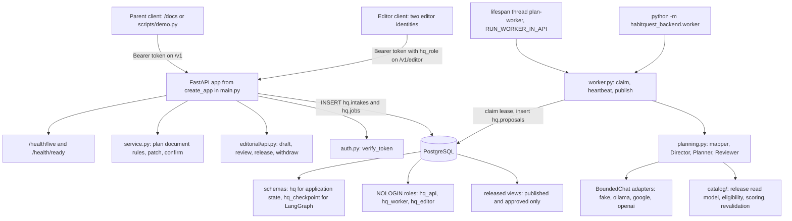

# System overview and component map

HabitQuest's first backend slice turns a parent's description of a child's pain points into a ranked, agent-picked, parent-confirmed and versioned habit plan, drawing every suggested activity from a separately maintained, two-person-reviewed catalog release. Three systems co-operate to do that, and they share exactly one thing: a PostgreSQL database. There is no message broker, no shared cache, no in-process call from the API to the planner.

| System | Runs as | Owns | Entry |
|---|---|---|---|
| FastAPI request process | `uvicorn habitquest_backend.main:app` | authentication, HTTP contracts, household writes, queue writes, parent edits and confirmation | [`main.py`](../../src/habitquest_backend/main.py) |
| Durable planning worker | separate process or a thread inside the API | claiming jobs, running the model pipeline, publishing proposals | [`worker.py`](../../src/habitquest_backend/worker.py) |
<!-- openwiki: broken internal link [../../supabase/migrations] file "../../supabase/migrations" does not exist. Fix the href or restore the target, then delete this comment. -->
| Postgres/Supabase schema | one database, three service roles | all durable state: household rows, queue rows, plan documents, catalog drafts, published releases, LangGraph checkpoints | [`supabase/migrations/`](../../supabase/migrations) |

Two end-to-end journeys span them: [parent planning run](../workflows/parent-planning-run.md) (API enqueues, worker plans, API confirms) and [editorial catalog release](../workflows/editorial-catalog-release.md) (editor drafts, a second editor approves, a release is built and published, planning reads it). This page is the map; the mechanics live on the pages it links to.

## What this slice does not contain

Read the README's scope line before looking for anything else: daily occurrences, completion approvals, Spark transactions, screen-time enforcement, world rendering, redemption and formal RAGAS/LangSmith experiments are explicitly later integrations. Proposed `points` fields are catalog metadata, not awards ([`README.md`](../../README.md), [`docs/implementation-plan.md`](../../docs/implementation-plan.md)). There is no frontend in this repository — `/docs` (OpenAPI) and `scripts/demo.py` are the only user-facing clients, and `demo.py` drives the API over HTTP with separate worker processes. Model-quality, family-erasure and retention work is also out of scope, which is why the README calls a hosted deployment test data until those exist.

## The component map

The API process and the worker never call each other: `hq.jobs` is the only channel, and the only two role boundaries that matter operationally are "who may write household rows" (`hq_api`) and "who may write proposals" (`hq_worker`). Process and lease mechanics are covered in [Runtime topology](runtime-and-processes.md); the tables and views in [Data model, migrations and persistence](data-model-and-persistence.md).

## Outward-facing surfaces

Everything a caller can reach is declared on one `FastAPI` object built by `create_app(settings)` at import time (`app = create_app()`): a parent router, an editor router mounted with `application.include_router(editorial_router(settings))`, and two health probes.

| Surface | Prefix / path | Auth | Purpose |
|---|---|---|---|
| Parent API | `/v1` | bearer token, any authenticated user | children, intakes, plan runs, proposals, plans, goals, plan flags |
| Editorial API | `/v1/editor` | bearer token **and** `app_metadata.hq_role = "editor"` | catalog drafts, two-person review, releases, withdrawal, unmatched-concern feedback |
| Liveness | `/health/live` | none | returns `{"status": "ok"}` without touching the database |
| Readiness | `/health/ready` | none | `SELECT 1 FROM hq.children LIMIT 0`; `503` when the database or migrations are unavailable, which is also the Render health check |

The parent routes are `POST/GET/PATCH /v1/children…`, `POST /v1/children/{id}/intakes`, `POST /v1/intakes/{id}/plan-runs` (requires an `Idempotency-Key` header), `GET /v1/plan-runs/{id}`, `POST /v1/plan-runs/{id}/cancel`, `GET/PATCH /v1/proposals/{id}`, `POST /v1/proposals/{id}/confirm`, and the `plan`, `goals` and `plan-flags` reads. The editor routes are generated per catalog kind (`habits`, `goals`, `concerns`, `chapters`) plus the release endpoints and `GET /v1/editor/catalog-requests`; the per-kind list route is registered last, deliberately, so `/{kind_name}` does not capture `/releases` or `/catalog-requests`. Route-level documentation is itself pinned by a test: `test_every_endpoint_is_documented` requires every OpenAPI operation to carry a summary, a description of at least 40 characters and a known tag.

Authentication shape is described in [Authentication, database roles and RLS boundaries](authentication-and-authorization.md); the important thing here is that both surfaces are served by the same process and the same database login, and are separated only by a claim check plus a different `SET LOCAL ROLE`.

## Module boundaries: who owns what

The package is small enough that a wrong boundary shows up as duplicated logic, so the split is deliberate.

| Module | Owns | Does not own |
|---|---|---|
| [`main.py`](../../src/habitquest_backend/main.py) | the app factory, lifespan, health probes, the parent dependency, all `/v1` parent handlers, the household bootstrap; it composes `service`, `catalog.repository` and the editorial router | planning rules, catalog authoring, SQL beyond its own statements |
| [`service.py`](../../src/habitquest_backend/service.py) | the plan *document* rules: `enqueue`, the seven patch operations in `edited()`, the publication limits in `apply_patch()`, `validate_sources`, `confirm`, `flag_plan`, `cue_loss_habits` | model calls, catalog reads beyond `load_release`, HTTP |
| [`planning.py`](../../src/habitquest_backend/planning.py) | the agent pipeline: prompts, `BoundedChat` provider adapters, `unsafe`, goal mapping validation, pick validation, the Director/Planner/Reviewer graph, template fallback | persistence, leases, HTTP, editorial rules |
| [`worker.py`](../../src/habitquest_backend/worker.py) | the durable loop: `claim`, `heartbeat`, `renew_loop`, `run_once`, publication fencing, retry classification, `store_catalog_requests` | anything a parent can address directly |
<!-- openwiki: broken internal link [../../src/habitquest_backend/catalog] file "../../src/habitquest_backend/catalog" does not exist. Fix the href or restore the target, then delete this comment. -->
| [`catalog/`](../../src/habitquest_backend/catalog) | the read model and deterministic decisions: frozen dataclasses, `load_release`, `eligible`, `score`/`template_plan`, `stale_references`, `validate_release`/`diff_items` | authoring, persistence, model calls |
<!-- openwiki: broken internal link [../../src/habitquest_backend/editorial] file "../../src/habitquest_backend/editorial" does not exist. Fix the href or restore the target, then delete this comment. -->
| [`editorial/`](../../src/habitquest_backend/editorial) | the authoring surface: `/v1/editor` routes, draft schemas, deterministic submit checks | publishing logic, which is in SQL functions |
| [`db.py`](../../src/habitquest_backend/db.py) | one transaction helper that selects `hq_api`/`hq_worker`/`hq_editor`, sets `statement_timeout` and publishes `app.parent_id` / `app.editor_id` | any business rule |
| [`config.py`](../../src/habitquest_backend/config.py) | `Settings`: database URL, model mode and credentials, lease/attempt/budget ceilings, JWT material, `run_worker_in_api` | deployment wiring, which is [`render.yaml`](../../render.yaml) |

Two consequences are worth internalising. First, **plan-document shape is a code contract, not a schema contract** — `build_proposal()` in `planning.py`, the patch operations in `service.py` and the SQL that reads `data->'active'` all have to change together. Second, **catalog authoring and planning only meet at `load_release()`**, which switches between the `released_*` and `release_*` view families; that function is the single place where "editor sees drafts" and "planner sees published content" are reconciled.

## Journey 1: parent onboarding and planning

1. `POST /v1/children` creates the household, the membership and the child row, writes the IANA timezone on the household, and stores `routine_schedule` — a cue plus weekdays per anchor (`morning`, `after_school`, `evening`, `bedtime`). The schedule is not cosmetic: `eligible()` rejects any habit whose `routine_anchor` has no cue.
2. `POST /v1/children/{id}/intakes` stores one round of free-text `concerns` plus `available_minutes` and an opt-in `store_feedback`.
3. `POST /v1/intakes/{id}/plan-runs` with an `Idempotency-Key` inserts a `queued` `hq.jobs` row (unique on `(parent_id, request_key)`) and returns `202` with the run id and a status URL.
4. The worker claims the job and runs `planning.generate()`: the mapper turns concerns into goal IDs from the current release; deterministic eligibility and scoring build shortlists and a reviewed template; the Director delegates to the `habit-planner` Planner, whose only tool is `search_catalog`; code validates every pick; the Reviewer must accept the final document, with one revision allowed before the reviewed template is used (`fallback: true`). Budget, deadline, cancellation and unsafe requests fail explicitly instead of publishing.
5. The worker's publication transaction re-checks its lease, the intake version, the plan version and `profile_version`, calls `validate_sources()`, and inserts `hq.proposals` — same UUID as the job — with the whole document in `data jsonb`.
6. The parent reviews `GET /v1/proposals/{id}`, optionally applies one edit per `PATCH` (each rebuilt from the release and re-checked against `max_active_habits`, daily minutes, cue availability and goal coverage; violations are `422` naming the rule), then confirms with `expected_plan_version` and `expected_proposal_version`. Confirmation revalidates every active habit and chapter against the current release and appends a new immutable `hq.plans` row.

Details, including every refusal code and the review-screen rules, are on [Parent planning run](../workflows/parent-planning-run.md); the queue machinery is on [Runtime topology](runtime-and-processes.md).

## Journey 2: editorial catalog release

1. An editor with `app_metadata.hq_role = "editor"` creates or revises one catalog version per entity (`habits`, `goals`, `concerns`, `chapters`); one open draft per entity, `409` otherwise.
2. `POST …/versions/{n}/submit` runs deterministic checks — level count and minutes, age bounds, linked goals exist, and a lexical lint for punishment, secrecy, dangerous activity, weight loss, diagnosis/treatment and coercive wording — then moves the version to `in_review`, where triggers freeze it.
3. A *different* editor approves or rejects with a reason. Approved versions are immutable; both rules are enforced by `SECURITY DEFINER` functions and table checks, not only by the API, and the API merely maps SQLSTATEs to HTTP (`42501`→403, `P0002`→404, `55000`→409, `22023`→422).
4. `POST /v1/editor/releases` builds a candidate pinning the latest approved, non-withdrawn version of every entity (or copies a published release for rollback). `GET …/diff` compares it with the current release; `GET …/validate` returns blocking `errors` and advisory `warnings`.
5. `POST …/publish` by an editor other than the builder flips the single `is_current` release. Withdrawal is the emergency path: it marks every approved version withdrawn, permanently, and flags each child's current plan that uses the habit.

Details are on [Editorial catalog release](../workflows/editorial-catalog-release.md); the immutability triggers and release tables are on [Data model, migrations and persistence](data-model-and-persistence.md).

## The seam: a published release is the contract

The two journeys meet at exactly one object. Planning never reads a draft: `load_release(conn)` reads `hq.current_release` and then the `released_*` views, which join `release_items` back to catalog rows under `published_at IS NOT NULL` and `status = 'approved'`. So a release is a *pin list*, not a copy, and an editor's draft is invisible to the worker until publication.

That seam is also where the system converts a stale plan into an explicit, recoverable failure:

- `service.validate_sources()` takes `hq.lock_release(...)` share locks, checks `policy_version`, reloads the release, and raises `409 replan_required` if any active habit or chapter was withdrawn, superseded or dropped. It runs at worker publication, at proposal confirmation, and (indirectly, per habit) during parent edits.
- A confirmed plan is never mutated. Superseded content surfaces instead as `hq.plan_flags` rows (`habit_withdrawn`, `cue_removed`) that the parent resolves, or as a `drop`/`upgrade` entry in the next proposal's `changes` list.

This is the system's main architectural invariant: **reviewed rows are the only content that can reach a child-facing plan**, and any drift between a confirmed plan and the current release is either blocked at confirmation or reported to the parent as a flag.

## Cross-cutting invariants

- **One database, three roles, zero ambient trust.** Every request opens a fresh connection and `SET LOCAL ROLE`; the identity travels as the transaction-local setting `app.parent_id` / `app.editor_id`, so a reused connection cannot leak identity. `hq_editor` has no grant on household tables at all.
- **Fencing over locking.** A worker's right to write is its leased row: `claim()`, `heartbeat()`, the budget `charge()` and the publication statements all match `lease_token` and `status='running'`. Cancelling clears the token, which is why an in-flight pipeline can finish and still publish nothing.
- **Fail closed on anything the model produces.** Mapping must quote the parent's words and stay inside the release; picks must come from server-scoped shortlists; the Reviewer must accept; anything else falls back to the reviewed template or fails the run.
- **Two deployment shapes, one code path.** `RUN_WORKER_IN_API=true` starts `serve()` on a daemon `plan-worker` thread in the lifespan — enough for one Render service, with the caveat that a sleeping instance stops the worker with it. Production sets it to `false` and runs `python -m habitquest_backend.worker` separately; nothing else changes.

## Where to start reading, and what pins it

<!-- openwiki: broken internal link [../../supabase/migrations] file "../../supabase/migrations" does not exist. Fix the href or restore the target, then delete this comment. -->
For a change in behaviour, start at the module that owns the decision, not at the route: routing in `main.py` / `editorial/api.py`, plan rules in `service.py`, model behaviour in `planning.py`, deterministic ranking in `catalog/scoring.py` and `catalog/eligibility.py`, and anything about publication or review in the SQL functions under [`supabase/migrations/`](../../supabase/migrations).

The tests are organised the same way and are the fastest confirmation that a boundary still holds: `tests/test_database_flow.py` (concerns → ready proposal → confirmed plan, and idempotent enqueue), `tests/test_proposal_patch.py` and `tests/test_apply_patch.py` (the edit rules and their refusal codes), `tests/test_recovery.py` and `tests/test_runtime_edges.py` (leases, budgets, cancellation, retry classification), `tests/test_final_boundaries.py` (harmful concerns failing closed, no invented chapter content, publication rolling back on a late deadline), `tests/test_editorial.py` and `tests/test_releases_and_checks.py` (two-person review, audit trail, diff and validation), `tests/test_catalog_schema.py` (drafts invisible through `released_*`, immutability guards), and `tests/test_hosting.py` (the in-API worker thread, adapter contracts, endpoint documentation). Fixtures truncate HabitQuest tables in a database whose name must end in `_test`, which is the operational guard against pointing the suite at real household data.
