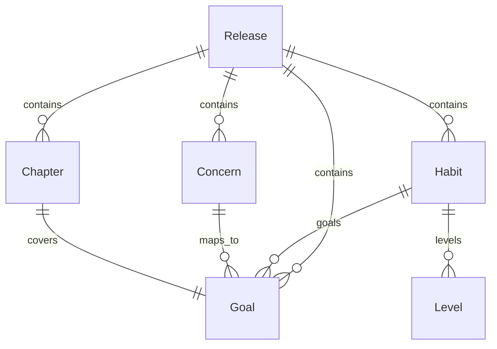
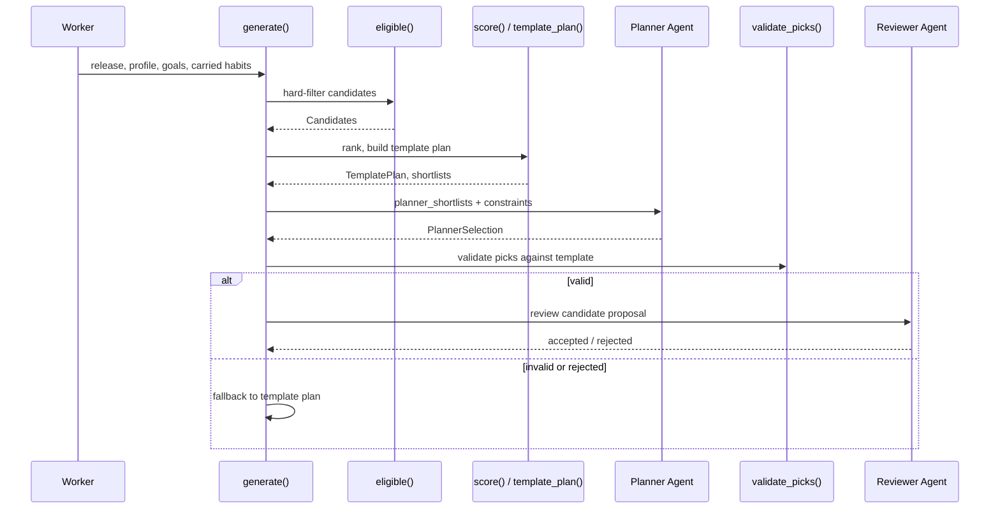

# Catalog model, eligibility, scoring and template coverage

The catalog is the single source of truth for what a child can be asked to do.
It is authored by editors, reviewed by a second editor, and published as an
immutable **Release**. The planning pipeline narrows a release
against a child profile through deterministic eligibility rules, ranks the
survivors, and produces a **template plan** that the LLM planner must not
weaken. This page documents the domain model, the filter pipeline, the scoring
breakdown, the template builder, and the coverage semantics that guard goal
satisfaction.

*Related pages:*
- [Data Model and Persistence](../architecture/data-model-and-persistence.md) —
  database tables and persistence design.
- [Planning Agents](planning-agents.md) — the LLM director, planner, reviewer
  and agent orchestration.
- [Editorial Catalog Release](../workflows/editorial-catalog-release.md) — the
  two-person review and publishing workflow.
- [Proposal Edits and Confirmation](../workflows/proposal-edits-and-confirmation.md)
  — how parents edit and confirm the generated proposal.

## Catalog domain model

The catalog is a collection of immutable versioned entities bundled together in a
`Release`. The in-memory model lives in
[models.py](repo://src/habitquest_backend/catalog/models.py) and is hydrated from
database views by [repository.py](repo://src/habitquest_backend/catalog/repository.py).


*Entity-relationship of a single Release: goals, concerns, habits with levels, and chapters.*

### Goal

A `Goal` is a high-level parenting objective – for example *"Build a consistent
bedtime preparation routine"*. Each goal has a reviewed title and description
(`id`, `version`, `title`, `description`).

### Concern

A `Concern` is a parent-facing pain-point label with synonyms. It maps to one or
more goals with a `weight`. The mapping is used by the *mapper* agent to turn
free-text parent concerns into catalog goal IDs.

### Habit

A `Habit` is a concrete, reviewable child activity. It is the richest entity in
the catalog:

| Field | Meaning |
|---|---|
| `id, version` | Composite identity within the release. |
| `title, instruction` | Editor-reviewed child-facing wording. |
| `min_age, max_age` | Age range this habit supports. |
| `routine_anchor` | One of `morning`, `after_school`, `evening`, `bedtime`. |
| `levels` | Ordered tuple of `Level` (`simple`, `standard`, `stretch`), each with `minutes` and `points`. |
| `goals` | `dict[goal_id, float]` — strength of the habit's link to each goal. |
| `tags` | Frozen set including `topic:...`, `access:...` and `interest:...` tags. |
| `variants` | Interest-based title/instruction overrides (e.g. a *space* variant). |
| `supports` | `dict[habit_id, str]` — prerequisite relationships to other habits. |
| `withdrawn` | Emergency flag; withdrawn habits are never eligible. |

The `presented()` method selects a variant if the child's interests match,
otherwise returns the base text. Variants may change wording but never the
activity itself.

### Chapter

A `Chapter` ties a `world` (e.g. `space`, `forest`, `city`) to a `goal_id` and
gives the narrative title for that goal in that world. Chapters are attached to
the proposal and used by the client app to render story content.

### Release

A `Release` is an immutable snapshot (`id`, `goals`, `concerns`, `habits`,
`chapters`) loaded through the read-only `released_*` views. Editors may also
load unpublished *candidate* releases through the `release_*` views for
validation and diffing.

[repository.py](repo://src/habitquest_backend/catalog/repository.py#L7-L55)
loads every entity row into its frozen dataclass, reconstructing nested JSON
into `Level`, `Habit`, `Goal`, `Concern` and `Chapter` instances.

### Child profile

The `ChildProfile` is the runtime eligibility input:

| Field | Meaning |
|---|---|
| `age_band` | One of `6-9` or `10-13`. |
| `interests` | Frozen set driving variant selection and the scoring interest bonus. |
| `accessibility` | Frozen set of needs, e.g. `short_instructions`. |
| `opted_in_topics` | Frozen set of `topic:` tags the parent has explicitly opted into. |
| `routine_schedule` | `dict[anchor, RoutineSlot(cue, days)]` — which anchors have an agreed cue. |

`profile_from_row()` builds a `ChildProfile` from an `hq.children` row.

## Eligibility pipeline

The `eligible()` function in
[eligibility.py](repo://src/habitquest_backend/catalog/eligibility.py#L16-L45)
is a deterministic hard filter. The LLM and the scoring layer only ever see the
`Candidate`s that pass it.

A `Candidate` bundles a qualifying habit, the subset of goal IDs it serves for
this call, the chosen level, and a `needs_cue` flag.

The predicates are applied **in code order** for every habit in the release:

1. **Withdrawn.** `habit.withdrawn` — emergency removal; the habit never
   surfaces.
2. **Serves at least one requested goal.** `served` is the intersection of
   `goal_ids` with `habit.goals`. If empty, the habit is irrelevant.
3. **Not already active.** `habit.id` must not be in `active_habit_ids`
   (carried forward from the current plan).
4. **Age band overlap.** The habit's `[min_age, max_age]` must fully cover the
   band's bounds. For `6-9` the band means ages 6 through 9, so the habit must
   satisfy `min_age <= 6 and max_age >= 9`.
5. **Opted-in topics.** Every `topic:` tag on the habit must have its suffix in
   `profile.opted_in_topics`.
6. **Accessibility tags.** Every `access:` tag the profile needs (`access:<need>`)
   must be present on the habit's tags.
7. **A level within available minutes.** Levels are tried in order
   `simple → standard → stretch`; the first whose `minutes <= available_minutes`
   is selected. If none fit, the habit is excluded even though the child could in
   principle do it later.
8. **Needs cue.** If the habit's `routine_anchor` is missing from
   `profile.routine_schedule`, `needs_cue` is set to `True`. The habit is still
   *eligible*, but it cannot be picked by the reviewed template or confirmed
   without a cue.

<!-- openwiki: mermaid parse failed and this diagram was converted to a text fence so it does not break rendering. Fix the diagram source and restore the mermaid fence. Parser error: Heuristic: an unescaped angle bracket inside a label breaks rendering; rephrase the label. -->
```text
flowchart TD
    H[Habit from Release] --> W{withdrawn?}
    W -->|yes| D[discard]
    W -->|no| G{serves a requested goal?}
    G -->|no| D
    G -->|yes| A{already active?}
    A -->|yes| D
    A -->|no| AG{covers age band?}
    AG -->|no| D
    AG -->|yes| T{topics opted in?}
    T -->|no| D
    T -->|yes| AC{accessibility met?}
    AC -->|no| D
    AC -->|yes| L{level fits minutes?}
    L -->|no| D
    L -->|yes| C[Candidate<br/>needs_cue?]
```
*Eligibility decision flow for each habit. Any predicate failing discards the habit; passing produces a Candidate with a chosen level and a needs_cue flag.*

Entry points:
- The worker calls `eligible()` in `generate()` before scoring.
- [planning.py](repo://src/habitquest_backend/planning.py) is the sole consumer of
the catalog pipeline end-to-end.

## Scoring and ranking

`score()` ([scoring.py](repo://src/habitquest_backend/catalog/scoring.py#L29-L43))
turns the eligible candidates into `Scored` objects. The ranking version
`RANKING_VERSION = "2026-10-29.1"` is stamped into every proposal; any change
here or to the scoring formula must bump it so that proposals are
version-traceable.

The score is a weighted sum of four components:

| Component | Source | Value |
|---|---|---|
| **Goal** | Sum over served goals of `(goal_priority_weight × habit.goals[goal])` | Higher when the habit strongly serves high-priority goals. Goal order matters: the first goal in the parent's list gets weight `1.0`, the last gets `1/N`. |
| **Interest** | `INTEREST_BONUS = 0.5` if any `interest:<i>` tag matches `profile.interests` | Rewards habits aligned with the child's stated interests. |
| **Prerequisite** | `PREREQ_BONUS = 0.3` if the habit `supports` another habit already present in the eligible set | Rewards chains (e.g., a preparatory habit). |
| **Level** | `-LEVEL_PENALTY[level]` (`simple: 0.0`, `standard: 0.1`, `stretch: 0.3`) | Penalises more demanding levels so the planner tends toward the simplest acceptable fit. |

Ties break by `habit.id` ascending, so the order is fully deterministic across
runs.

### Shortlists

`shortlists(scored, goal_ids, size=3)` returns, per goal, the top `size` scored
candidates that serve that goal. `size=None` disables the cap and is used
internally for coverage calculations.

`planner_shortlists()` extends this for the LLM planner: it skips `needs_cue`
options and **guarantees inclusion of the template's active pick** for each goal.
This lets the planner reproduce the reviewed deterministic baseline even if the
cue-ready shortlist is short.

## Template plan and coverage

`template_plan()` ([scoring.py](repo://src/habitquest_backend/catalog/scoring.py#L79-L128))
is the deterministic baseline that must always be achievable. It walks the goals
in priority order and greedily picks the highest-ranked cue-ready option for
each uncovered goal, respecting `max_active` habits and `available_minutes`.

### PRIMARY_STRENGTH and coverage semantics

`PRIMARY_STRENGTH = 0.8` is the threshold that distinguishes a strong habit-goal
link from a weak one.

A habit **covers** a goal when either:

1. `habit.goals[goal] >= PRIMARY_STRENGTH` (strong link); **or**
2. the habit has a weak link (`< PRIMARY_STRENGTH`) **and** no cue-ready
   alternative for that goal remains unpicked.

This second rule means a weak link only "counts" as coverage when all dedicated
(cue-ready) options for the goal are already chosen or exhausted. If a dedicated
habit is still available, the weak link does **not** cover the goal; instead the
goal is deferred until the dedicated habit can be scheduled.

The coverage invariants are enforced by `habit_covers()` and `covered_goals()`;
`validate_picks()` in
[planning.py](repo://src/habitquest_backend/planning.py#L285-L325)
uses them to reject any LLM selection that drops a goal the reviewed template
covered. The hypothesis-driven property test in
[test_catalog_scoring.py](repo://tests/test_catalog_scoring.py#L203-L225)
asserts these invariants against random catalog inputs.

### Template plan construction

For each goal in priority order:

1. If the goal is already covered by a previously chosen habit, skip it.
2. If no shortlist exists for the goal, mark it `unresolved[goal] = "no_catalog_entry"`.
3. If every candidate for the goal is already chosen (it only weakly serves a goal
   already picked), consider it covered in passing.
4. If every remaining candidate needs a cue, mark it `unresolved[goal] = "needs_cue"`.
5. Otherwise, pick the highest-ranked **fitting** candidate that has a strong
   link; if none, pick the highest-ranked fitting candidate (weak link). If no
   candidate fits within the remaining minutes or the active-habit cap,
   mark `unresolved[goal] = "deferred"`.

Chosen habits are deduplicated by ID (one habit counts once even if it serves
multiple goals). After the pass, a strict coverage check ensures that every
picked habit's strong links are reflected in `covered_goals`; any missed goals are
re-marked `deferred`.

The template plan returns:
- `active` — ordered tuple of picked `Scored` habits.
- `future` — remaining scored candidates not in `active`, sorted by score.
- `unresolved` — map of goal → reason code.

### Unresolved reason codes

| Reason | Meaning |
|---|---|
| `needs_cue` | No cue is configured for this goal's anchor; parent must add one. |
| `no_catalog_entry` | No habit in the release serves this goal. |
| `deferred` | Time or habit-count limits prevent scheduling; may become available later. |
| `paused` | Set by the LLM planner when the parent explicitly pauses a goal (not produced by the template). |

## Proposal and publication pipeline

The catalog pipeline feeds into the planning agent loop documented in
[Planning Agents](planning-agents.md). The flow is:

1. **Load release** — `load_release()` gets the current published release.
2. **Map concerns** — an LLM maps parent text to catalog goal IDs.
3. **Prioritise goals** — highest confidence first, then mention order.
4. **Eligibility** — `eligible()` filters candidates.
5. **Score & shortlist** — `score()` and `planner_shortlists()` prepare the
   ranked options.
6. **Template plan** — `template_plan()` creates the deterministic baseline.
7. **Planner agent** — the LLM picks within the shortlists; its output is
   validated by `validate_picks()`.
8. **Reviewer agent** — checks safety and fidelity.
9. **Build proposal** — `build_proposal()` assembles the JSON with goals, active
   habits, future candidates, chapters, shortlists, coverage, questions and
   fallback flag.


*Planning pipeline sequence: eligibility → scoring → template → agent picks → validation → review → proposal.*

The `fallback` flag in the proposal is set `true` when the agent produced an
invalid selection or failed review, and the system falls back to the reviewed
template picks. The test in
[test_goal_coverage.py](repo://tests/test_goal_coverage.py#L9-L30)
verifies that the fallback mechanism cannot silently drop a template-covered
goal.

## Release loading and versioning

`load_release(conn, release_id=None, candidate=False)`
([repository.py](repo://src/habitquest_backend/catalog/repository.py#L7-L55))
resolves the release ID from `hq.current_release` when none is supplied. With
`candidate=True`, editors can load any release (published or not) through the
editor-only `release_*` views for validation and diffing; the default
`candidate=False` uses the read-only `released_*` views consumed by the planning
worker.

All active habits and chapters in a confirmed plan are revalidated on load
against the then-current release. `stale_references()` in
[revalidation.py](repo://src/habitquest_backend/catalog/revalidation.py)
raises `replan_required` if a habit was withdrawn or superseded, or a chapter
version changed.

## Editorial lifecycle (brief)

The full editorial workflow is covered in
[Editorial Catalog Release](../workflows/editorial-catalog-release.md). In
brief:

- Editors draft, submit, and approve goals, concerns, habits and chapters.
- A *builder* editor assembles a release from the latest approved versions of
  every entity.
- `validate_release()` checks integrity: every goal must have a chapter in every
  world; habits must have levels; references must stay inside the release.
- A *publisher* (different editor) publishes the release, making it current.
- `withdraw_habit()` is an emergency operation that immediately flags all plans
  using that habit.

## Configuration and bump notes

- `RANKING_VERSION` in
  [scoring.py](repo://src/habitquest_backend/catalog/scoring.py#L7) — bump when
the scoring formula, component weights, penalty values, or tie-breaking logic
change.
- `PROMPT_VERSION` in
  [planning.py](repo://src/habitquest_backend/planning.py#L43) — bump when the
planner, mapper, director or reviewer prompts change in ways that alter
behaviour.

Both versions are written into every proposal so downstream consumers can
trace which logic produced a given plan.
