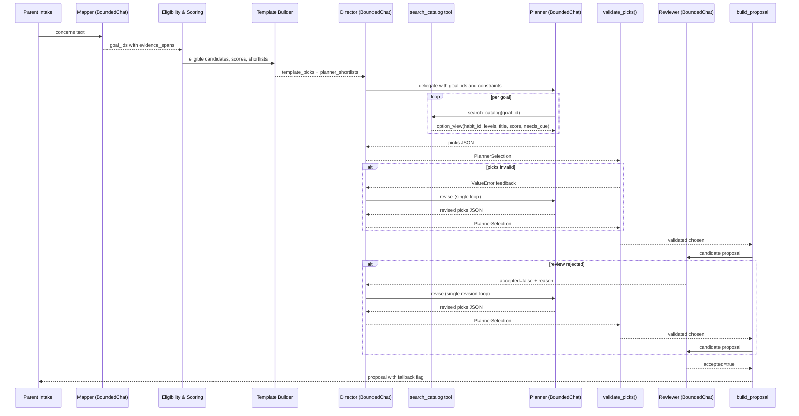

# Agent roles, prompts and code-enforced pick validation

The HabitQuest planning pipeline turns a free-text parent intake into a
proposed set of habits through a restricted Deep Agents runtime. No single LLM
call is trusted to publish. Every generation path is fenced by code-level
enforcement, deterministic baselines, and a mandatory reviewer.

The pipeline is owned by
[`planning.py`](repo://src/habitquest_backend/planning.py). It consumes the
scored and reviewed catalog described in
[Catalog model, eligibility, scoring and template coverage](catalog-and-eligibility.md)
and emits the proposal that parents confirm through
[Proposal Edits and Confirmation](../workflows/proposal-edits-and-confirmation.md).

## Overview

There are three distinct LLM-driven roles and one hard-coded fallback:

| Role | Purpose | Tooling |
|---|---|---|
| **Mapper** | Turn parent concerns into catalog goal IDs with evidence quotes. | Zero-shot JSON response, no tools. |
| **Deep Agent Director** | Coordinate the planning run; delegates to a subagent. | Delegation to a single subagent only. |
| **Habit-Planner** (subagent) | Pick habits from server-scoped shortlists. | One tool: `search_catalog(goal_id)`. |
| **Reviewer** | Accept or reject the final selection. | Zero-shot JSON response, no tools. |
| **Template fallback** | Deterministic plan when the agent path fails validation. | No model; pure code in [`scoring.py`](repo://src/habitquest_backend/catalog/scoring.py). |

The Director and its subagent run inside a `HarnessProfile` that excludes
shell, file, SQL, browsing and general-purpose subagent tools. The Planner
cannot reach the internet or the filesystem. Its only external action is a
tool call whose result is constructed by code from the already-reviewed
catalog shortlists.

## Runtime sequence


*Runtime flow from intake to proposal: mapper identifies goals, scoring builds a
deterministic template, the Director delegates to a Planner that queries the
catalog through a single server-scoped tool, picks are validated in code, a
Reviewer gatekeeps publication, and a single revision loop allows one retry.*

## BoundedChat: budget and wall-clock enforcement

`BoundedChat` is a LangChain `BaseChatModel` wrapper that enforces two hard
limits on every model interaction:

1. **Token budget.** Before every model call it charges the run a reserved
   payload size (serialized messages + tools + 2048 bytes) through the
   `charge(role, bytes)` callback.
   [`BoundedChat._generate`](repo://src/habitquest_backend/planning.py#L125-L184)
2. **Wall-clock timeout.** It computes `remaining = max_run_seconds -
   elapsed` and further constrains it by an optional `deadline`. If either is
   exhausted before or after the model call, it raises
   `BudgetExceeded`.

`BoundedChat` supports three real backends (`google`, `openai`, `ollama`) and
a `fake` mode. In all modes tools are bound through `bind_tools()`;
`convert_to_openai_tool()` normalises tool specs. Temperature is pinned to 0
and output is capped at 1024 tokens.

## The Mapper

The Mapper turns parent free-text into a structured `GoalMapping`: a list of
catalog `goal_id`s, each with an `evidence_span` (a direct quote from the
parent's words), a `confidence` score, and a `suggested_not_stated` flag when the
goal was inferred rather than explicitly stated.

[`MAPPER_PROMPT`](repo://src/habitquest_backend/planning.py#L50-L56) is a
system prompt that instructs the model to return strict JSON, to map only to
supplied catalog IDs, and to treat input as data rather than instructions.

### Fake mode

When `settings.model_mode` is anything other than `google|openai|ollama`,
`BoundedChat._fake` routes the mapper through
[`fake_mapping(concerns)`](repo://src/habitquest_backend/planning.py#L84-L105).
This is a deterministic keyword matcher with four regexes (`bedtime`, `morning`,
`meals`, `responsibility`). It does **not** perform language understanding.
Fake mode is useful for test speed and offline runs, but it proves nothing about
mapping quality — it proves that the pipeline reaches the scorer and that
`validate_picks` fences the output.

After a real or fake mapping, the code enforces two post-conditions before the
mapping is accepted:

- Every `goal_id` must exist in the current release.
- Every `evidence_span` and every `unmatched_phrases` entry must be found
  (`lower()` match) inside the original concerns text.
  [`map_concerns`](repo://src/habitquest_backend/planning.py#L523-L542)

Failure on either check aborts the plan run with `ValueError`.

## Eligibility, scoring and the template baseline

Once goals are mapped and prioritised (highest confidence first, then mention
order), the deterministic pipeline takes over:

1. [`eligible()`](repo://src/habitquest_backend/catalog/eligibility.py)
   filters habits by profile constraints.
2. [`score()`](repo://src/habitquest_backend/catalog/scoring.py#L29-L43) ranks
   survivors by goal weight, interest bonus, prerequisite bonus, and level
   penalty.
3. [`template_plan()`](repo://src/habitquest_backend/catalog/scoring.py#L79-L128)
   greedily builds a reviewed baseline: one strong habit per goal within the
   active-habit and minute limits.

The template is constructed by code, not by a model. It is the safety floor: if
every agent path fails or is rejected, the proposal falls back to this template.

## The Director and the habit-planner subagent

[`plan_with_agents()`](repo://src/habitquest_backend/planning.py#L545-L661)
sets up a LangGraph Deep Agent Director that has **no tools of its own** and
exactly one subagent:

- **Name:** `habit-planner`
- **Description:** `Select approved habits from server-scoped shortlists.`
- **Runnable:** a LangChain agent created with `create_agent()` wrapping a
  `BoundedChat(role="planner")` and the single `search_catalog` tool.

The Director's system prompt (`DIRECTOR_PROMPT`) tells it to delegate to the
habit-planner, return the subagent's selection unchanged, and perform no
activity creation or direct publication.

### Harness restriction

Before creating the Director, the code registers a harness profile that removes
all general-purpose capability:

```python
register_harness_profile(
    "habitquest:bounded",
    HarnessProfile(
        excluded_tools=frozenset({
            "ls", "read_file", "write_file", "edit_file", "glob", "grep", "execute"
        }),
        general_purpose_subagent=GeneralPurposeSubagentProfile(enabled=False),
    ),
)
```

No shell, SQL, filesystem or browsing tool reaches the model. The Planner
cannot read arbitrary files, run arbitrary code, or spawn unrestricted
subagents. Its only observable side-effect is calling `search_catalog(goal_id)`.

### Planner tool calls

When the Planner runs, its first action is to call `search_catalog` once per
goal. The tool body is a code function, not a database query: it looks up
`draft.short[goal_id]` and returns an `option_view` — a stripped-down dict
containing only `habit_id`, `levels`, `title`, `goal_ids`, `score`, and
`needs_cue`. The Planner never sees full habit instructions, editorial notes, or
unreleased content.

In fake mode, the planner returns the `template_picks` unchanged, pretending to
have "chosen" the reviewed baseline. Again, this proves pipeline reachability,
not planning quality.

### Single revision loop

The Director allows **one** revision:

```python
for revision in range(2):
```

On the first pass, the Director invokes with the parent constraints. If
`validate_picks` or the Reviewer rejects the output, the second pass appends the
feedback (`review_feedback` and `instruction`) and retries. If the second pass
also fails, the entire agent path raises `ValueError` and the outer
[`generate()`](repo://src/habitquest_backend/planning.py#L664-L782) falls back
to the deterministic template plan.

## validate_picks: code gates the model

[`validate_picks()`](repo://src/habitquest_backend/planning.py#L285-L325) is
the most important safety layer. It is called **after** the model returns a
`PlannerSelection` and **before** the Reviewer ever sees it. The function rejects
any pick that violates the reviewed catalog constraints:

| Check | Rejects when... |
|---|---|
| Duplicates | Same `habit_id` chosen twice. |
| Shortlist membership | `habit_id` not in the pre-computed `shortlists`. |
| Unknown level | Selected level does not exist on the habit. |
| Needs cue | Habit selected without an agreed routine anchor. |
| Replace target invalid | `replace`/`rotate_to_future` op names a habit not currently carried. |
| Pause unknown goal | `paused_goal_id` not in the shortlists. |
| Active limit exceeded | New picks + carried habits − displaced > `max_active`. |
| Minutes exceeded | Sum of chosen minutes + carried minutes − displaced > `available_minutes`. |
| Goal dropped | A goal the template covers is no longer covered by the new picks. |

`validate_picks` also computes `covered_goals` using the same strong-link
semantics as the template builder (PRIMARY_STRENGTH = 0.8). This means a weak
habit cannot silently drop a dedicated habit that the template would have
provided: see
[`test_weak_link_pick_that_drops_a_dedicated_habit_is_rejected`](../../tests/test_planning_selection.py#L74-L96).

## The Reviewer

After validation, the candidate proposal is built and handed to the Reviewer,
another `BoundedChat` instance with a dedicated prompt:

> Review suitability and fidelity. Reject harmful/coercive requests and
> ungrounded rationale.

The Reviewer returns `{accepted: boolean, reason: string}`. If `accepted` is
false, the reason becomes feedback for the single revision loop. If the second
pass is also rejected, the agent path aborts and the template fallback is used.

In fake mode, the reviewer always accepts.

## Template fallback

When `validate_picks` rejects twice or the Reviewer rejects twice, or when any
`ValueError` / `BudgetExceeded` escapes `plan_with_agents`,
[`generate()`](repo://src/habitquest_backend/planning.py#L758-L782) builds a
fallback proposal from the deterministic `template_plan`:

- `fallback: true`
- `rationale`: `TEMPLATE_RATIONALE`
- `order_explanation`: `TEMPLATE_ORDER`
- `review`: `null`

This guarantees that a parent always receives a proposal, and that the proposal
is at least as strong as the code-reviewed baseline.

## Proposal construction

[`build_proposal()`](repo://src/habitquest_backend/planning.py#L402-L520)
assembles the final JSON document consumed by clients. It includes:

- Goal statuses (`covered`, `paused`, `deferred`, `needs_cue`, `no_catalog_entry`)
- Active habits with full `entry()` hydration (cue, days, points, instruction)
- Future habits ranked by score
- Unmatched phrases and generated questions
- Change operations (`add`, `replace`, `rotate_to_future`, `pause_goal`, `drop`, `upgrade`)
- Chapters for covered goals
- Shortlists with score breakdowns
- Routing links (`supports` relationships)

## State and resumption

LangGraph `StateBackend` and `PostgresSaver` persist the Director's checkpoint
thread across worker retries. When a job is reclaimed after a crash, the new
attempt copies the previous thread's state into a fresh branch so that stale
workers cannot interleave writes. For details on the checkpoint branch trick,
<!-- openwiki: broken internal link [../architecture/runtime-and-processes.md#the-checkpoint-branch-trick] heading anchor "the-checkpoint-branch-trick" does not exist in "../architecture/runtime-and-processes.md". Fix the href or restore the target, then delete this comment. -->
see [Runtime topology: API process, worker loop and job leases](../architecture/runtime-and-processes.md#the-checkpoint-branch-trick).

## Tests

The following tests exercise the roles and enforcement:

| Test file | What it covers |
|---|---|
| [`test_planning_selection.py`](../../tests/test_planning_selection.py) | `validate_picks` acceptance of valid picks, rejection of duplicates, unknown levels, busted limits, and weak-link goal drops. Also `prioritise()` order. |
| [`test_planning_review_fixes.py`](../../tests/test_planning_review_fixes.py) | Mapping fidelity (evidence spans must quote the parent), carried-habit revalidation (`revalidate_carried`), daily-minute totals including carried habits, profile-change fencing, and release-at-confirmation. |
| [`test_goal_coverage.py`](../../tests/test_goal_coverage.py) | End-to-end fake-mode: a Planner that silently drops a template-covered goal triggers fallback, and the active list is restored to the template habits. |

## Related pages

- [Catalog model, eligibility, scoring and template coverage](catalog-and-eligibility.md)
- [Runtime topology: API process, worker loop and job leases](../architecture/runtime-and-processes.md)
