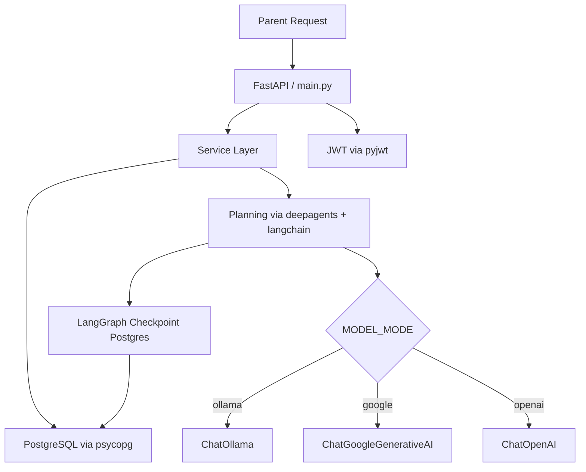
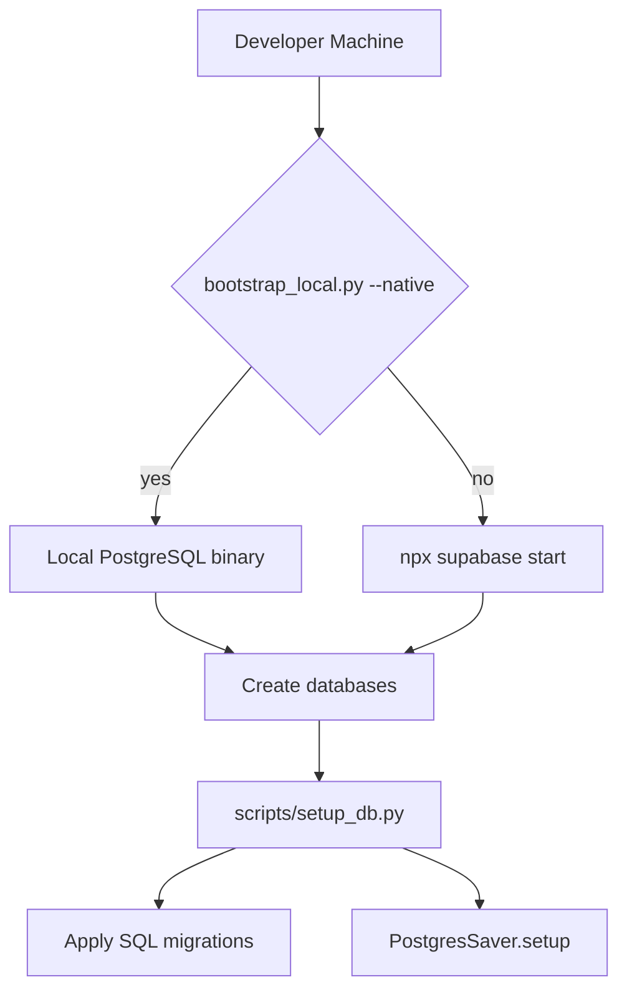

# Dependency inventory: runtime, dev and Node tools

This page lists every direct dependency declared in the repository, why it exists, and where it is first imported.

- **16 runtime dependencies** are declared in `pyproject.toml` under `[project]` `dependencies`.
- **7 dev dependencies** are declared in the `dev` dependency group.
- **1 build backend** (`uv_build`) is declared under `[build-system]`.
- **1 Node devDependency** (`supabase`) is declared in `package.json` and used only for local tooling.

---

## Runtime dependencies

| # | Package | Why it is used | First import |
|---|---------|----------------|-------------|
| 1 | `deepagents` | Multi-agent orchestration harness (`create_deep_agent`, `HarnessProfile`, `register_harness_profile`, `StateBackend`). | `planning.py` `from deepagents import ...` |
| 2 | `fastapi[standard]` | HTTP API framework; the `standard` extra pulls in Uvicorn automatically. | `main.py` `from fastapi import ...` |
| 3 | `httpx` | HTTP client for the demo script that exercises a running API. | `demo.py` `import httpx` |
| 4 | `langchain` | Agent creation helper (`create_agent`). | `planning.py` `from langchain.agents import create_agent` |
| 5 | `langchain-core` | Core abstractions: `BaseChatModel`, message types, `RunnableConfig`, tools, output schemas. | `planning.py` `from langchain_core...` |
| 6 | `langchain-google-genai` | Google Gemini chat model wrapper (`ChatGoogleGenerativeAI`). | `planning.py` `from langchain_google_genai import ChatGoogleGenerativeAI` |
| 7 | `langchain-ollama` | Ollama chat model wrapper (`ChatOllama`) for local-only development. | `planning.py` `from langchain_ollama import ChatOllama` |
| 8 | `langchain-openai` | OpenAI-compatible chat model wrapper (`ChatOpenAI`) for Nebius or similar endpoints. | `planning.py` `from langchain_openai import ChatOpenAI` |
| 9 | `langgraph` | LangGraph checkpointing framework. | `worker.py` `from langsmith import tracing_context` (runs under LangGraph) and `PostgresSaver` is part of the langgraph-checkpoint-postgres integration |
| 10 | `langgraph-checkpoint-postgres` | PostgreSQL-backed checkpoint store for LangGraph (`PostgresSaver`). Used at **build/setup time** in `setup_db.py` to create checkpoint tables. Also imported at runtime in `worker.py`. | `setup_db.py` `from langgraph.checkpoint.postgres import PostgresSaver` |
| 11 | `langsmith` | Observability and tracing (`tracing_context`). | `worker.py` `from langsmith import tracing_context` |
| 12 | `psycopg[binary,pool]` | PostgreSQL adapter; `binary` provides the C extension, `pool` provides connection pooling. | `db.py` `import psycopg` |
| 13 | `pydantic` | Data validation and serialization (`BaseModel`, `Field`, `field_validator`). | `schemas.py` `from pydantic import BaseModel` |
| 14 | `pydantic-settings` | Settings class that reads `.env` and environment variables (`BaseSettings`). | `config.py` `from pydantic_settings import BaseSettings` |
| 15 | `pyjwt[crypto]` | JWT signing and verification (`jwt.encode`, `jwt.decode`, `PyJWKClient`); the `crypto` extra enables cryptographic key handling. | `auth.py` `import jwt` |
| 16 | `python-dotenv` | Load `.env` files in demo scripts, local token generation, and tests. | `demo.py` `from dotenv import load_dotenv` |

### Key runtime notes

- **`fastapi[standard]` pulls Uvicorn** as a transitive dependency, so the project does not need to list Uvicorn directly.
- **`uv` itself is not a runtime dependency** on Render. The build process exports requirements with `uv` and installs them with `pip`, so the deployed service does not depend on `uv` at runtime.
- **`langgraph-checkpoint-postgres` is needed both at setup time and at runtime.** `setup_db.py` calls `PostgresSaver.from_conn_string(...).setup()` to create the `hq_checkpoint` schema and tables during database bootstrapping. `worker.py` then uses `PostgresSaver` to resume and checkpoint agent runs.
- **Multi-model support:** `planning.py` imports all three model-provider packages (`langchain-google-genai`, `langchain-ollama`, `langchain-openai`). The active one is selected at runtime by `model_mode` from [settings](../operations/deployment-and-migrations.md). See [Model Providers](../integrations/model-providers.md) for the provider matrix.

Runtime request flow from FastAPI through service, planning, and model tiers.

---

## Dev dependencies

The `dev` dependency group is installed automatically by `uv sync` in CI and when developers run tests locally.

| # | Package | Role in the workflow |
|---|---------|----------------------|
| 1 | `hypothesis` | Property-based testing for catalog scoring logic. Displays randomized inputs found by Hypothesis strategies in score-calculation tests. |
| 2 | `mypy` | Static type checking via `uv run python -m mypy src`. |
| 3 | `pytest` | Test runner invoked by **pytest** (`uv run python -m pytest`). |
| 4 | `pytest-asyncio` | Async test support for async API endpoints. |
| 5 | `pytest-cov` | Coverage reporting; CLI output and XML/HTML artifacts in CI. |
| 6 | `pytest-socket` | Prevents unit tests from opening real network sockets. |
| 7 | `ruff` | Unified linter and formatter invoked by `uv run ruff check` and `uv run ruff format`. |

### Dev workflow integration

The CI pipeline (`.github/workflows/test.yml`) runs the dev stack in order:

1. `uv run ruff check src tests scripts`
2. `uv run ruff format --check src tests scripts`
3. `uv run python -m mypy src`
4. `uv run python -m pytest --cov=habitquest_backend --cov-report=...`

Coverage is configured in `pyproject.toml` with `fail_under = 100` and branch coverage enabled.

---

## Build backend

`[build-system]` in `pyproject.toml` declares:

- `requires = ["uv_build>=0.12.23,<0.13.0"]`
- `build-backend = "uv_build"`

`uv_build` is the PEP 517 build backend used by `uv` to build and install the `habitquest-backend` package. It replaces `setuptools` or `hatchling` in this repository.

---

## Node devDependency

`package.json` declares a single dependency:

- `supabase: 2.122.0`

This is the **Supabase CLI**, pinned for reproducible local environment setup. It is only invoked by `scripts/bootstrap_local.py`: when the `--native` flag is omitted, the script runs `npx supabase start` to launch PostgreSQL and the Supabase stack via Docker. It is never used at application runtime.

Build-time setup flow: Node supabase CLI is used only when Docker/Supabase is chosen over native PostgreSQL.

---

## What to update after adding a dependency

1. Add the package to `pyproject.toml` in the correct group.
2. Record the import site and purpose in this page.
3. Run `uv sync --locked` and `uv run python -m pytest` to verify the lockfile and test suite still pass.
4. If the dependency opens network sockets (e.g. a new HTTP client), make sure `pytest-socket` rules or socket-disabling markers are updated in the [Verification Strategy](../testing/verification-strategy.md) page.

---

## Related pages

- [Model Providers](../integrations/model-providers.md) — How `MODEL_MODE` selects among the three LLM drivers.
- [Deployment and Migrations](../operations/deployment-and-migrations.md) — How `setup_db.py` applies SQL schema migrations and checkpoint tables.
- [Network Calls and Egress](../operations/network-calls-and-egress.md) — Which dependencies initiate outbound connections.
- [Verification Strategy](../testing/verification-strategy.md) — How `pytest-socket`, `hypothesis`, and coverage interact with the test suite.
