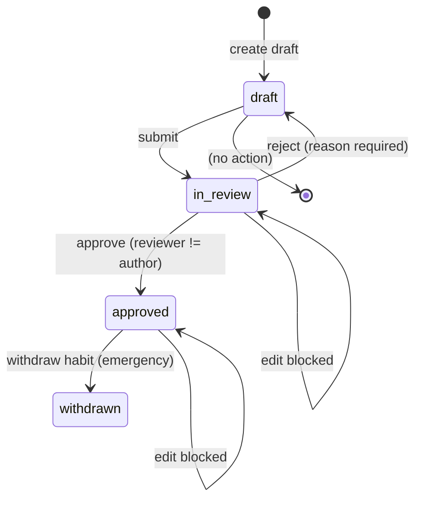

# Workflow: two-person catalog review, release and withdrawal

The catalog is authored through a two-person review workflow. One editor creates and submits a draft; a second editor approves or rejects it. Approved versions flow into a numbered release that is built, validated, diffed and published. An emergency withdrawal permanently removes a habit and flags every child's current plan that uses it.

## Editor authentication and route ordering

Every endpoint under `/v1/editor` is protected by an `editor` dependency: a missing credential returns `401`, a token without the `hq_role=editor` claim returns `403`, and a token with the claim is verified and passed as the actor UUID to the database transaction. The dependency mirrors the parent `verify_token` path but additionally requires `(app_metadata or {}).get("hq_role") == "editor"`.

The router's catch-all `/{kind_name}` listing endpoint is registered **last** so its path template does not capture `/releases` or `/catalog-requests`.

## Catalog version lifecycle

Each of the four entity kinds — `habits`, `goals`, `concerns`, `chapters` — is versioned independently as `(id, version)` with status `draft`, `in_review`, `approved`, or `rejected`. The lifecycle is driven by HTTP endpoints backed by `SECURITY DEFINER` functions in the database.

*A catalog version moves from draft to in_review on submit, and to approved or rejected by a second editor. Approved versions are immutable; withdrawal is an emergency edge that permanently retires a habit.*

### State semantics

| Status | Meaning |
|---|---|
| `draft` | The author can edit content freely. Only one open draft (draft or in-review) may exist per entity id. |
| `in_review` | Frozen. No edits allowed. A second editor must approve or reject. |
| `approved` | Immutable. The content is eligible for release inclusion. |
| `rejected` | Returned to draft with a reason stored in `hq.catalog_audit`. |
| `withdrawn` | An emergency state reachable only for habits via `withdraw`. It sets `withdrawn_at` and `withdrawn_reason` on every approved version. |

## API endpoints

### Draft creation and editing

| Endpoint | Method | Purpose | Auth requirement |
|---|---|---|---|
| `/{plural}/{entity_id}/versions` | `POST` | Creates version 1 of a new entity, or the next version of an existing one, if no open draft exists. Records the calling editor as author. 409 if an open draft already exists. | Editor |
| `/{plural}/{entity_id}/versions/{version}` | `PUT` | Replaces a draft's content. 409 if the version is not draft. | Editor |
| `/{kind_name}/{entity_id}/versions/{version}` | `GET` | Reads a version with its full detail row and audit trail. | Editor |
| `/{kind_name}` | `GET` | Lists versions of one kind; `?status=in_review` is the review queue. | Editor |

### Lifecycle transitions

| Endpoint | Method | Purpose | Rules |
|---|---|---|---|
| `/{kind_name}/{entity_id}/versions/{version}/submit` | `POST` | Moves a draft to `in_review`. | Runs deterministic checks first; if any findings, returns `422` and status stays `draft`. |
| `/{kind_name}/{entity_id}/versions/{version}/approve` | `POST` | Approves a version in review. | The approver must differ from the author; enforced by the database function. |
| `/{kind_name}/{entity_id}/versions/{version}/reject` | `POST` | Returns a version to `draft`. | Requires a `reason` body. Rejector must differ from author. |

### Release management

| Endpoint | Method | Purpose |
|---|---|---|
| `/releases` | `GET` | Lists all catalog releases, newest first, with builder, publisher, and current flag. |
| `/releases` | `POST` | Builds a new, unpublished release. With `source_release_id`, copies a published release as rollback. |
| `/releases/{release_id}/diff` | `GET` | Compares a release with the current one: added, removed, and re-versioned items per entity kind. |
| `/releases/{release_id}/validate` | `GET` | Validates structural integrity. Errors block publication. |
| `/releases/{release_id}/publish` | `POST` | Publishes a release. Publisher must differ from builder. Validation errors return `422`. |

### Emergency and feedback

| Endpoint | Method | Purpose |
|---|---|---|
| `/habits/{entity_id}/withdraw` | `POST` | Immediately and permanently withdraws a habit. Returns how many children's current plans were flagged. |
| `/catalog-requests` | `GET` | Lists anonymised unmatched concerns, most frequent first. No child or household data included. |

## Submit-time checks

Submit runs two kinds of check in Python before calling `hq.transition_version`. Both are **advisory**; the version only reaches `in_review` if they pass. The database independently enforces immutability and transition rules through triggers and `SECURITY DEFINER` functions.

### Deterministic checks

- **Level count**: 1–3 levels.
- **Age bounds**: `min_age` and `max_age` within 6–13, with `min_age <= max_age`.
- **Linked goals**: goals referenced by the entity exist in `hq.goals`.
- **Non-empty goals**: habits and concerns must reference at least one goal.

### Lexical lint

A regex lint scans title, instruction, variant texts, and level instructions for prohibited content categories:

| Code | Pattern meaning |
|---|---|
| `punishment` | Physical or behavioural punishment language. |
| `secrecy` | Encouraging secrecy from parents or caregivers. |
| `dangerous_activity` | Knives, stoves, chemicals, fire, etc. |
| `weight_loss` | Diet, weight, calories, body-shaming. |
| `diagnosis_treatment` | Medical/treatment advice, diagnosis, medication. |
| `coercive_wording` | "Or else", "no excuses", "obey", "forced". |

Concern labels are parent-facing pain-point descriptions, not suggested activities, so they are **not** linted. Any match returns a finding code; the submit response is `422` with a `reasons` array, and the version remains `draft`.

## Two-person rules

The workflow enforces separation of duties at multiple points:

- **Reviewer must differ from author**: `hq.transition_version` raises `42501` if the actor UUID equals `created_by` on an `approve` or `reject` action.
- **Publisher must differ from builder**: `hq.publish_release` raises `42501` if the actor equals `built_by`.
- **Column defaults**: `created_by` is set to `hq.my_editor()` by a `DEFAULT`, so an editor cannot spoof authorship.

These are database-level checks inside `SECURITY DEFINER` functions, not merely API guards.

## Immutability and guards

The database enforces immutability through triggers rather than application convention:

- `guard_review_version` freezes a version in `in_review`; direct `UPDATE` to the same status is blocked with SQLSTATE `55000`.
- `guard_approved_version` blocks any change to an approved row except `withdrawn_at`/`withdrawn_reason`, and blocks reversion of withdrawal.
- `guard_habit_detail` and `guard_concern_detail` lock the parent row with `FOR SHARE` before allowing detail-table writes, preventing an approval from racing with an update.
- `guard_published_release` blocks changes to published release rows except `is_current` and `notes`.
- `guard_release_items` blocks insert, update, or delete against items of a published release.

The API maps these database exceptions to HTTP status codes through the `REFUSALS` dictionary:

| SQLSTATE | HTTP |
|---|---|
| `42501` | 403 (privilege / separation rule) |
| `P0002` | 404 (version or release not found) |
| `55000` | 409 (wrong status, already published, already withdrawn) |
| `22023` | 422 (bad parameter, e.g. missing reason) |

## Draft details and normalization

Habit drafts contain nested structures: levels, goal strengths, prerequisites, tags, and interest-based variants. The `write_details` helper normalises these into detail tables:

- `hq.habit_levels`: one row per `(habit_id, version, level)`.
- `hq.habit_goals`: one row per `(habit_id, version, goal_id, strength)`.
- `hq.habit_prereqs`: one row per `(habit_id, version, supports_habit_id, kind)` where kind is `prepares`.
- `hq.habit_tags`: one row per tag.
- `hq.habit_variants`: one row per `(habit_id, version, interest, title, instruction)`.

For concerns, `hq.concern_goals` stores weighted goal mappings. Goals and chapters have no detail tables.

## Release build and validation

A release is built from the latest approved, non-withdrawn version of every catalog entity. The build can also act as a rollback: with `source_release_id`, it copies the items of a published release, omitting any habit versions that were withdrawn since that release.

Validation produces `errors` (blocking) and `warnings` (advisory):

- **Errors**: missing `(world, goal)` chapter, chapter referencing a goal outside the release, concern without goals, habit without levels, withdrawn habit present, reference to goal, habit, or concern outside the release.
- **Warnings**: a goal with no habit that covers an age band.

The `diff` endpoint compares a candidate release against the current one using the `diff_items` function, classifying each entity as added, removed, or changed (re-versioned).

### Publication consequence

Publishing a release makes it current for all new planning. Open proposals whose habits were changed in the new release are rejected on confirmation with a `replan_required` error.

## Emergency withdrawal

Withdrawing a habit is immediate and permanent:

- Every approved version of the habit is marked withdrawn.
- An audit entry `approved` → `withdrawn` is recorded in `hq.catalog_audit`.
- Each child's current plan that includes the habit receives a `habit_withdrawn` plan flag.
- Open proposals that reference the habit fail confirmation.
- New release builds and rollback copies automatically omit the withdrawn habit.

## View family segregation

Service roles (`hq_api`, `hq_worker`) see only published, approved catalog content through the `released_*` views. Editors see any release (published or not) and any version status through the `release_*` and `*_version_details` views. `load_release` switches between them at runtime using `candidate=True` for editor operations.

## Related pages

- [Authentication, database roles and RLS boundaries](../architecture/authentication-and-authorization.md) — JWT verification, role switching, and the `hq_editor` trust chain.
- [Data model and persistence](../architecture/data-model-and-persistence.md) — catalog tables, release tables, immutability triggers, and migration design.
- [Catalog and eligibility](../concepts/catalog-and-eligibility.md) — the domain model, eligibility pipeline, and scoring that consume a published release.
