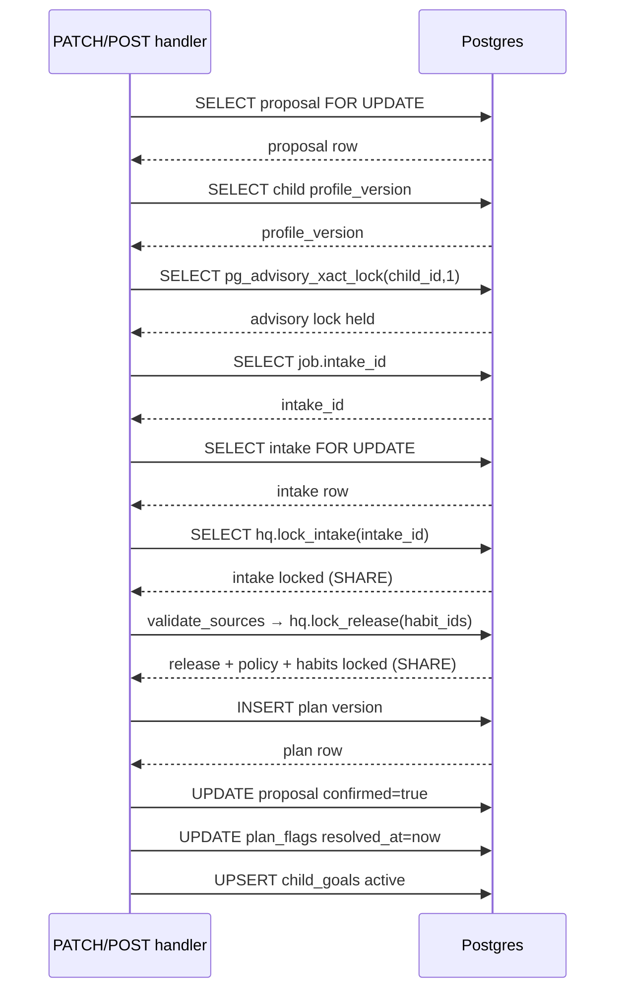

# Proposal edits, publication rules and confirmation

After the worker produces a proposal, the parent reviews it through the screen delivered by `GET /v1/proposals/{proposal_id}`. The proposal contains mapped goals, active habits with level/minutes/cue/days, future candidates, scored shortlists per goal, chapter outlines, questions, rationale and a review result. The parent may then apply a single edit at a time via `PATCH /v1/proposals/{proposal_id}`, check the result, and finally confirm the proposal via `POST /v1/proposals/{proposal_id}/confirm`.

This page documents the seven edit operations, how each edit rebuilds its affected habit from the reviewed catalog release, the publication rules that are re-checked after every edit, and the confirmation step that turns the proposal into an immutable plan version.

*Related pages:*
- [Parent planning run](parent-planning-run.md) — the intake, planning worker and proposal generation.
- [Catalog and eligibility](../concepts/catalog-and-eligibility.md) — goals, habits, chapters, eligibility and coverage semantics.
- [Data model and persistence](../architecture/data-model-and-persistence.md) — tables, version fields and RLS policies.

## The seven parent edit operations

Each edit is a single JSON body whose `edit` field is one of seven operations defined in [`schemas.py`](repo://src/habitquest_backend/schemas.py#L114-L171). The handler requires `expected_proposal_version`, and every accepted edit increments `proposals.version` by one.

| Operation | What it does |
|---|---|
| `remove_goal` | Drops a goal from `goals` and all habits that cover it. |
| `reorder_goals` | Re-orders the `goals` array without adding or removing entries. |
| `change_level` | Rebuilds one active habit at a different level (simple/standard/stretch), preserving cue and days. |
| `change_schedule` | Changes `cue` and `days` on one active habit without touching its level or rebuild. |
| `swap_habit` | Replaces one active habit with another from the shortlist, rebuilding the new habit from the release. |
| `promote_future` | Moves a habit from `future` to `active`, rebuilding it from the release at the chosen level. |
| `demote_active` | Moves an active habit to `future`; the habit must no longer be needed for coverage. |

The edit logic lives in [`service.py`](repo://src/habitquest_backend/service.py#L155-L231). All operations run against the **current catalog release**, not the release state that existed when the proposal was generated, so an edit can discover that a habit has been withdrawn or superseded.

### Rebuilding from the reviewed release

Any operation that introduces a habit into `active` (change_level, swap_habit, promote_future) rebuilds the habit entry from the current release using the same function the planner used originally. [`built_entry()`](repo://src/habitquest_backend/service.py#L135-L141) calls `entry()` in [`planning.py`](repo://src/habitquest_backend/planning.py) with the habit, goal list, chosen level and child profile, then overlays preserved fields such as `cue`, `days`, `covers` and `added_in_plan_version`.

This means the parent cannot edit a habit into a state that never existed in the catalog. If a level is requested that the habit does not define, [`level_of()`](repo://src/habitquest_backend/service.py#L128-L132) raises `ValueError`, which the handler turns into `422`. If the habit version in the proposal is stale, [`released()`](repo://src/habitquest_backend/service.py#L121-L125) raises `ValueError` naming the stale reason, also `422`.

### Swap, promote and demote semantics

- **`swap_habit`** — The new habit must be in the shortlist for at least one goal covered by the old habit, and must not already be active. The replaced habit is returned to `future` with score `0`. [`swap_habit`](repo://src/habitquest_backend/service.py#L184-L209)

- **`promote_future`** — The habit must still exist in the release, must not be withdrawn, and must have a cue-ready anchor in the child's profile. It is rebuilt at the requested level and appended to `active`; its `covers` includes only goals where the habit has a `PRIMARY_STRENGTH` link. [`promote_future`](repo://src/habitquest_backend/service.py#L216-L228)

- **`demote_active`** — The habit is removed from `active` and appended to `future`. Unlike the other moves, demotion does not immediately fail on coverage. Instead, the post-edit coverage check decides whether the remaining active habits still cover every goal that was covered before. [`demote_active`](repo://src/habitquest_backend/service.py#L210-L215)

## Publication rules re-checked after every edit

After the edit mutates the in-memory proposal document, [`apply_patch()`](repo://src/habitquest_backend/service.py#L234-L308) re-runs the same rules the planner respected when it built the original proposal. A violation raises `ValueError`; the [`patch_proposal`](repo://src/habitquest_backend/main.py#L268-L311) handler catches it and returns `422 Unprocessable Entity` with the rule name as the message prefix.

The limit and budget values are the child's **daily totals**, not a "remaining" budget. `available_minutes` is the total daily minutes the parent declared at intake, and `max_active_habits` is the policy cap. This design keeps the rules simple and stateless: the parent does not have to track how many minutes a previous plan already consumed.

### The five rule checks

1. **`max_active_habits`** — After the edit, `len(active)` must not exceed the policy cap (currently 3, read from `hq.policy`). If it would, the parent must demote an active habit first.

2. **`available_minutes`** — The sum of `minutes` across all active habits must not exceed `available_minutes`. If a level change or promotion would push the total over the daily budget, it is rejected.

3. **`needs_cue`** — Every active habit's `routine_anchor` must have a defined cue in the child's `routine_schedule`. This is enforced inside `built_entry()`; a missing cue raises before the limit checks run.

4. **`coverage`** — No goal that was previously `covered` may become uncovered. The strict coverage rule is explained in detail below.

5. **`chapter`** — Every covered goal must have an approved chapter in the child's world. If promoting a goal creates a covered goal with no chapter, the edit is rejected.

### The 409 versus 422 split

`409 Conflict` means "the world changed underneath you; reload and try again." `422 Unprocessable Entity` means "your edit violates a structural rule; change the edit and try again."

| Trigger | Status | What the parent must do |
|---|---|---|
| `expected_proposal_version` mismatch | 409 | Reload the proposal; another edit was applied. |
| Profile `version` changed since proposal was built | 409 | Request a new proposal from the current profile. |
| Proposal is expired or already confirmed | 409 | Start a new intake and planning run. |
| `max_active_habits` exceeded | 422 | Demote an active habit first, then retry. |
| `available_minutes` exceeded | 422 | Demote a habit or choose a lower level. |
| `needs_cue` — missing routine anchor | 422 | Add the cue to the child's profile first. |
| `coverage` — a goal would drop | 422 | Remove the goal explicitly, or swap within its shortlist. |
| `chapter` — no approved world chapter | 422 | Cannot promote this goal in this world. |
| Habit withdrawn or version superseded | 422 | Choose a different habit; the catalog changed. |

### Strict coverage and the weak-link rule

[`PRIMARY_STRENGTH = 0.8`](repo://src/habitquest_backend/catalog/scoring.py#L12) is the threshold that separates a strong habit-goal link from a weak one. A habit covers a goal strongly when `habit.goals[goal] >= PRIMARY_STRENGTH`. A weak link only counts as coverage when **no cue-ready alternative for that goal is left inactive** — whether in the shortlist or as a future candidate. [`apply_patch()`](repo://src/habitquest_backend/service.py#L255-L288)

This is why demoting a weakly-linked habit can fail even though another habit still lists the goal: the remaining habit is not a dedicated alternative for that goal, so the goal would drop back to deferred. The parent must either keep one of the dedicated alternatives active, or explicitly remove the goal first.

Conversely, a demoted habit returns to `future` and becomes an alternative again. If a weakly-linked habit was covering a goal only because its dedicated alternative was active, demoting the dedicated habit makes the weak link valid coverage again — but only if the demoted habit itself has a defined cue. This circular dependency is why the coverage check inspects both `active` and `future` after every edit.

## Confirmation: atomic, versioned and revalidated

`POST /v1/proposals/{proposal_id}/confirm` requires `expected_plan_version` and `expected_proposal_version`. It is the only operation that writes to `hq.plans`, and it is designed to be safe against concurrent edits, catalog changes and retries.

### Lock ordering and idempotency

The confirmation step acquires locks in a strict order to prevent deadlocks and races:

*Lock sequence during confirmation: proposal row lock → child advisory lock → intake row lock → catalog lock (via lock_release).*

1. **Proposal row lock** — `SELECT * FROM hq.proposals WHERE id=%s FOR UPDATE`. This fences out concurrent confirmation or patch attempts on the same proposal.

2. **Child advisory lock** — `pg_advisory_xact_lock(hashtextextended(child_id,1))`. The integer `1` distinguishes this from the lock used during enqueue (`hashtextextended(parent_id,0)`). This serializes confirmation with respect to profile edits and other planning runs for the same child.

3. **Intake lock** — `SELECT * FROM hq.intakes WHERE id=%s FOR UPDATE`, followed by [`hq.lock_intake(intake_id)`](repo://supabase/migrations/202610290004_intake_switch.sql#L36-L42). `lock_intake` is a `SECURITY DEFINER` function that `FOR SHARE`s the intake row after verifying the caller's RLS membership. Without it, a concurrent profile update could change the intake's child relationship after the intake row is read but before the plan is inserted.

4. **Catalog lock** — [`validate_sources()`](repo://src/habitquest_backend/service.py#L47-L60) calls [`hq.lock_release(habit_ids)`](repo://supabase/migrations/202610290003_profile.sql#L35-L44), a `SECURITY DEFINER` function that `FOR SHARE`s the onboarding policy row, the current release row, and every referenced habit version row. This prevents a catalog withdrawal or a new release from interleaving with confirmation.

### Version checks inside confirmation

Before inserting the plan, confirm() verifies four version snapshots:

- **Proposal not expired** — `expires_at <= now()` is checked; expired proposals return `409`.
- **Intake version match** — `intake["version"] == proposal["intake_version"]`. If the intake was edited after the proposal was generated, the run is stale and returns `409`.
- **Proposal version match** — `proposal["version"] == expected_proposal_version`. Same semantics as the patch handler.
- **Plan version match** — `expected_plan_version == proposal["base_plan_version"] == current_version(conn, child_id)`. If a newer plan was confirmed after the proposal was built, returns `409`.
- **Profile version match** — `proposal["data"]["profile_version"] == child["profile_version"]`. If the profile changed, returns `409`.
- **Policy version match** — inside `validate_sources()`, `data["policy_version"]` is compared to the current policy row. If policy changed, returns `409 "Policy changed; request a new reviewed proposal"`.
- **Source revalidation** — `stale_references()` in [`revalidation.py`](repo://src/habitquest_backend/catalog/revalidation.py#L4-L20) checks every active habit and chapter against the current release. If a habit was withdrawn, superseded, or removed from the release, or if a chapter version changed, returns `409 "replan_required: ..."`.

### Side effects of confirmation

When all checks pass, the handler performs three writes in the same transaction:

1. **Insert plan** — A new row in `hq.plans` with `version = expected_plan_version + 1`, copying the proposal's `data` JSONB and recording the release ID. The plan is immutable; later changes create a new version, never an update.

2. **Resolve old flags** — `UPDATE hq.plan_flags SET resolved_at=now() WHERE ... plan_id IN (SELECT id FROM hq.plans WHERE child_id=%s AND id<>%s)`. Every open flag on superseded plans is resolved because the new plan replaces them.

3. **Upsert child goals** — For each goal in the proposal with `status == "covered"`, an `INSERT ... ON CONFLICT (child_id, goal_id) DO UPDATE` sets `status='active'`, `since_plan_version` and `source_intake_id`. The `WHERE hq.child_goals.status <> 'active'` clause means re-confirming an already-active goal preserves its original plan version and intake attribution — history stays attributable even when a goal is reaffirmed.

### Idempotent replay by proposal_id

The first thing `confirm()` does after locking the proposal is check whether a plan already exists with this `proposal_id`: [`previous = conn.execute("SELECT * FROM hq.plans WHERE proposal_id=%s").fetchone()`](repo://src/habitquest_backend/service.py#L67-L69). If `previous` exists, it is returned immediately with `200`, making confirmation safe to retry. Because the entire confirmation is wrapped in a transaction and the proposal row is locked, two concurrent confirmations both see `previous IS NULL`, one inserts, and the other blocks until the first commits, then sees the inserted row and returns it.

## Tests that defend the edit and confirmation rules

| File | What it proves |
|---|---|
| [`test_apply_patch.py`](repo://tests/test_apply_patch.py) | Unit-level edit semantics: level rebuilds, schedule changes, swap validation, promote with limits and cues, demote vs coverage, weak-link coverage withdrawal, stale version rejection. |
| [`test_proposal_patch.py`](repo://tests/test_proposal_patch.py) | API-level edit rules: version increment, 422 on bad levels and missing cues, 409 after profile change or stale version, remove_goal, promote against current release, demote requiring goal removal first, swap within shortlist, confirmed proposal rejects further patches. |
| [`test_security_and_changes.py`](repo://tests/test_security_and_changes.py) | Confirmation integrity: concurrent confirmation creates only one plan, idempotency key cannot cross intakes, confirmation versions and goal lifecycle, other household cannot confirm or read proposal. |
| [`test_final_boundaries.py`](repo://tests/test_final_boundaries.py) | Boundary and durability: confirmation fenced by `validate_sources` lock, deadline expiry rolls back publication, harmful concerns blocked before planning, missing chapter causes failure not invention, slow model rejected after budget exceeded, lease renewal survives DB failure. |
